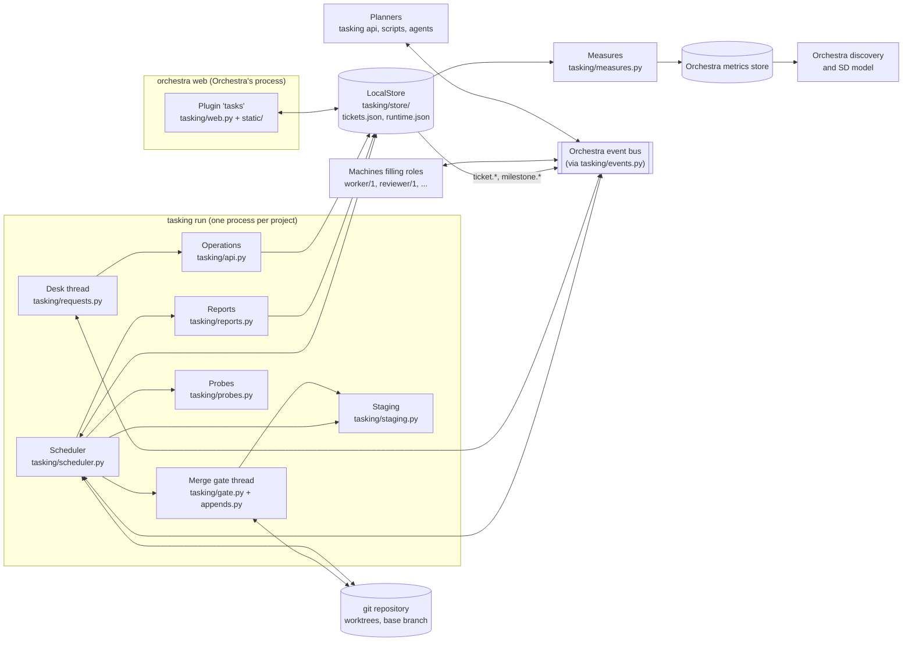
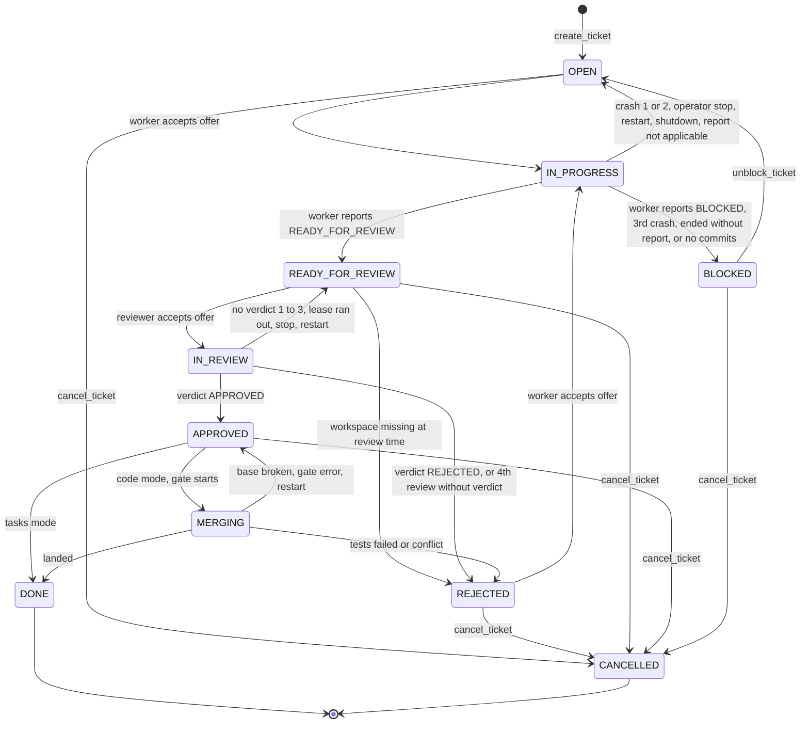
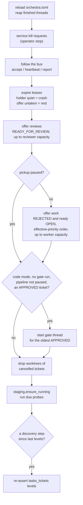
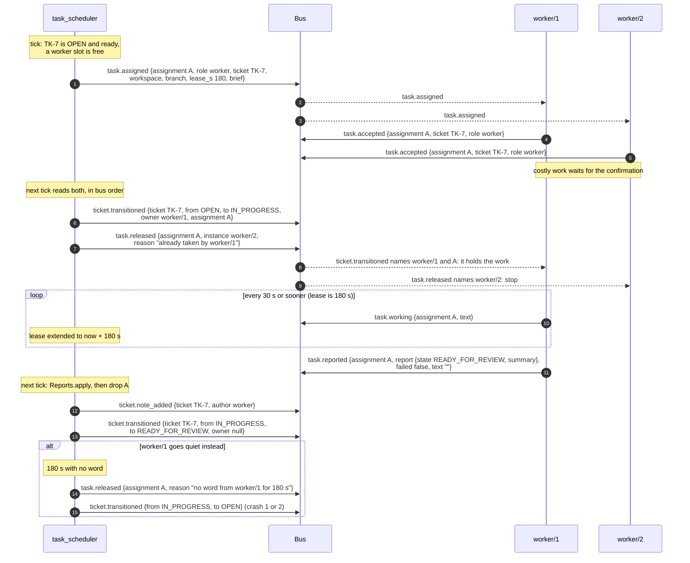
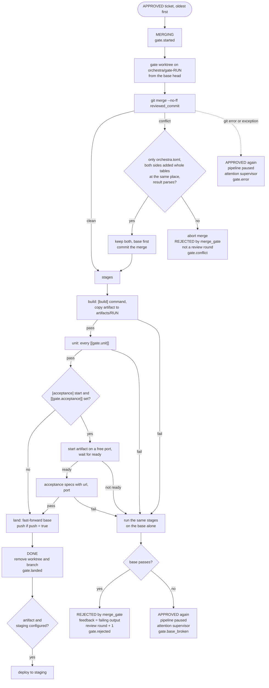
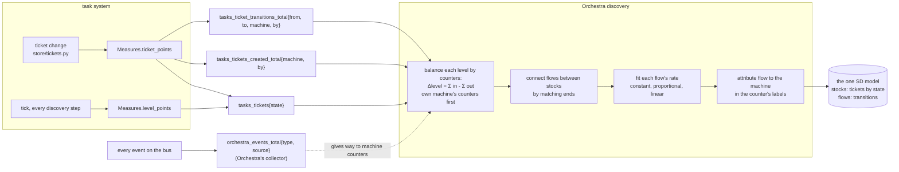

# Architecture of the task system

This document explains how the task system works and what a machine must do to work with it.
It is written for the owner and for engineers new to the code. `SPEC.md` is the design and
`AGENTS.md` the rules; this document describes the code as it is on `main` at `7495e9a` and
names the module behind every statement. Where the two disagree, the code is what runs.

Contents:

1. [What it is](#1-what-it-is)
2. [Components](#2-components)
3. [Tickets and milestones](#3-tickets-and-milestones)
4. [The state machine](#4-the-state-machine)
5. [The scheduler](#5-the-scheduler)
6. [The assignment protocol](#6-the-assignment-protocol)
7. [What a report makes of a ticket](#7-what-a-report-makes-of-a-ticket)
8. [The desk: requests on the bus](#8-the-desk-requests-on-the-bus)
9. [Attention](#9-attention)
10. [Work modes: tasks and code](#10-work-modes-tasks-and-code)
11. [The merge gate](#11-the-merge-gate)
12. [Staging and probes](#12-staging-and-probes)
13. [Metrics, and how they become stocks](#13-metrics-and-how-they-become-stocks)
14. [The plugin](#14-the-plugin)
15. [Event reference](#15-event-reference)
16. [Write a worker or a reviewer](#16-write-a-worker-or-a-reviewer)
17. [State on disk](#17-state-on-disk)
18. [Sharp edges](#18-sharp-edges)

## 1. What it is

The task system keeps **tickets** and **milestones**, decides which ticket is worked next and
by which **role** (`worker`, `reviewer`), **offers** that work on Orchestra's event bus, and
applies what comes back. In code mode it also lands approved branches through a **merge
gate** and keeps a **staging** instance of the last build that passed.

It is an Orchestra plugin named `tasks`. Orchestra's web UI shows its pages, and
`orchestra run` keeps its scheduler running.

What it is not:

- It runs no machine besides its own scheduler. Whatever fills a role is another program that
  speaks the contract in section 6. In this repository that is a shell runner and a file checker
  (`demo/machines/`); elsewhere it can be anything, an AI agent included.
- It knows nothing about what a machine is made of. It reads an acceptance's `source` (who holds
  the work) and a report's `report` (the verdict). Nothing else.
- Only the scheduler changes a ticket's state (`AGENTS.md` rule 1). A person or a planner
  changes tickets only by sending a request on the bus.

## 2. Components



| Module | What it does |
|---|---|
| `tasking/model.py` | `Ticket`, `Milestone`, `Note`, the `State` enum, `TRANSITIONS`, `RECOVERY`, readiness (`is_ready`) and effective priority (`effective_priorities`). Pure data and rules. |
| `tasking/store/` | The only code that reads or writes the JSON state. `tickets.py` holds tickets, milestones and notes; `runtime.py` holds what the scheduler holds while running; `files.py` does whole-file writes under one `fcntl` lock; `local.py` joins the halves as `LocalStore`. Every change also publishes an observation and writes metrics. |
| `tasking/scheduler.py` | The loop: follows the bus, owns leases, makes offers, starts the gate, keeps staging and probes going, re-asserts the levels. |
| `tasking/reports.py` | What a worker's or reviewer's report (or its absence) makes of a ticket. |
| `tasking/assignments.py` | The assignment contract: event names, `LEASE_S`, `HEARTBEAT_S`, the offer's `brief`. Its docstring table is the single source of truth for the five assignment events. |
| `tasking/requests.py` | Request names, the `Desk` that answers them, and `ask()` for callers. |
| `tasking/api.py` | The operations the desk applies (`create_ticket`, `cancel_ticket`, ...). |
| `tasking/events.py` | `Events`, a thin layer over `orchestra.events.Events`: `emit()` sets the subject to the ticket or milestone; `read()` flattens `data` into the event dict. Attention helper. |
| `tasking/gate.py`, `tasking/appends.py`, `tasking/git.py` | The merge gate, its one automatic conflict resolution, and thin `git` wrappers. |
| `tasking/staging.py`, `tasking/probes.py` | The staging instance and the `[[probes]]` checks. |
| `tasking/measures.py` | The series written to Orchestra's metrics store. |
| `tasking/config.py` | The task system's sections of `orchestra.toml`, and the state paths. |
| `tasking/web.py`, `tasking/static/` | The plugin: pages, every-page scripts, API routes, the declared machine and process. |
| `tasking/cli.py`, `tasking/status.py` | The `tasking` command and its one-screen status. |

Two processes touch the store: the scheduler (`tasking run`) and Orchestra's web server, which
loads the plugin. They share the store through the file lock. The web server writes only the
operator's controls (section 14).

## 3. Tickets and milestones

`tasking/model.py`, enforced by `tasking/store/tickets.py`.

A **milestone** has an id `M<n>`, a name, a description, an order and a status, `open` or
`closed`. Every ticket belongs to one. A milestone closes only when all its tickets are `DONE`
or `CANCELLED`. Closed is final: it never reopens and never receives tickets
(`close_milestone`, `create_ticket`, `update_ticket` refuse otherwise).

A **ticket** has an id `<ticket_prefix>-<n>` and these fields:

| Field | Set by | Meaning |
|---|---|---|
| `title`, `description`, `acceptance`, `objective`, `verification` | planner | what to do, how the reviewer tells it is done, why, how the gate's tests prove it |
| `priority` | planner | 1 is soonest; default 5 |
| `depends_on` | planner | ticket ids that must be `DONE` first; each must exist |
| `milestone_id` | planner | must name an open milestone |
| `state`, `state_since` | scheduler | see section 4 |
| `owner` | scheduler | the instance (`worker/1`) holding it; cleared when it leaves an active state |
| `branch`, `reviewed_commit` | scheduler | code mode only |
| `blocked_reason`, `feedback`, `rejected_by` | scheduler | what a planner reads, and what the next worker is told |
| `review_rounds`, `worker_turns`, `reviewer_rejections`, `gate_rejections` | scheduler | counters |
| `created_by` | scheduler | the `by` label of the request that made it |
| `version` | store | optimistic concurrency; every change adds one |

**Notes** are a log per ticket (`Note`: author, text, kind `note|review|gate|blocker|crash`).
The worker's summary, the reviewer's verdict, the gate's result, a blocker, a crash, a planner's
note all go here.

**Readiness** is derived (`is_ready`): a ticket is ready when it is `OPEN`, every dependency is
`DONE`, and its milestone is open.

**Effective priority** (`effective_priorities`) orders pickup. A ticket takes the best priority
of anything that depends on it, directly or not, so raising one ticket pulls its prerequisites
forward. Age then improves it by one level per `aging_days_per_level` days (default 2; 0 turns it
off). It never goes below 1.

## 4. The state machine

`State` and `TRANSITIONS` in `tasking/model.py`. The store refuses any move not in the table
(`check_transition`), and refuses `BLOCKED` without a `blocked_reason`.

| Group | State | Meaning |
|---|---|---|
| waiting | `OPEN` | waits for a worker |
| | `REJECTED` | sent back by a reviewer, the gate or the task system; waits for a worker, who gets `feedback` |
| | `READY_FOR_REVIEW` | waits for a reviewer |
| | `APPROVED` | approved; in code mode waits for the gate |
| | `BLOCKED` | waits for a planner's decision; `blocked_reason` says why |
| active | `IN_PROGRESS` | held by a worker instance |
| | `IN_REVIEW` | held by a reviewer instance |
| | `MERGING` | in a gate run (code mode) |
| terminal | `DONE` | approved, and in code mode landed |
| | `CANCELLED` | a planner cancelled it |

There are exactly these ten states. Active states each have a waiting state they fall back to
(`RECOVERY`): `IN_PROGRESS` to `OPEN`, `IN_REVIEW` to `READY_FOR_REVIEW`, `MERGING` to
`APPROVED`.



Who makes each move, and the `by` label the move carries in the metrics (section 13):

| From | To | Cause | Code | `by` |
|---|---|---|---|---|
| `OPEN`, `REJECTED` | `IN_PROGRESS` | first acceptance of a worker offer; `worker_turns` + 1 | `Scheduler._accept` | the holder's machine name |
| `IN_PROGRESS` | `READY_FOR_REVIEW` | worker report; in code mode the branch head becomes `reviewed_commit` | `Reports._worker` | `worker` |
| `IN_PROGRESS` | `BLOCKED` | worker report `BLOCKED` with a reason | `Reports._worker` | `worker` |
| `IN_PROGRESS` | `BLOCKED` | third crash in a row; a turn that ended on purpose with no report; code mode with no commits beyond the base | `Reports._block` | `task_scheduler` |
| `IN_PROGRESS` | `OPEN` | first or second crash (lease ran out, unusable report, `failed: true`) | `Reports._worker` | `task_scheduler` |
| `IN_PROGRESS` | `OPEN` | operator stop, restart, shutdown, an outcome that threw | `Reports.back_to_waiting` | `task_scheduler` |
| `READY_FOR_REVIEW` | `IN_REVIEW` | first acceptance of a reviewer offer | `Scheduler._accept` | the holder's machine name |
| `READY_FOR_REVIEW` | `REJECTED` | the folder or worktree is gone at review time; not a review round | `Scheduler._assign` → `Reports.reject` | `task_scheduler` |
| `IN_REVIEW` | `APPROVED` | verdict `APPROVED` | `Reports._review` | `reviewer` |
| `IN_REVIEW` | `REJECTED` | verdict `REJECTED`; `review_rounds` + 1 | `Reports.reject` | `reviewer` |
| `IN_REVIEW` | `REJECTED` | the fourth review in a row without a verdict | `Reports.reject` | `task_scheduler` |
| `IN_REVIEW` | `READY_FOR_REVIEW` | no verdict (up to three times), lease ran out, operator stop, restart, shutdown | `Reports._review`, `back_to_waiting` | `task_scheduler` |
| `APPROVED` | `DONE` | tasks mode: right after `APPROVED` | `Reports._review` | `reviewer` |
| `APPROVED` | `MERGING` | the gate takes the oldest approved ticket | `Scheduler._gate` | `task_scheduler` |
| `MERGING` | `DONE` | the gate landed it | `run_gate` | `task_scheduler` |
| `MERGING` | `REJECTED` | conflict (not a review round) or a failed stage (a review round); `rejected_by = merge_gate` | `run_gate.reject` | `task_scheduler` |
| `MERGING` | `APPROVED` | base branch broken, gate error, or a restart during the run | `run_gate`, `recover` | `task_scheduler` |
| `BLOCKED` | `OPEN` | `unblock_ticket` request | `api.handle` | the request's `by` |
| any waiting state | `CANCELLED` | `cancel_ticket` request; refused while active | `api.handle` | the request's `by` |

Two things change no state at all: an offer nobody accepts, and a heartbeat.

`TRANSITIONS` also allows `IN_PROGRESS`, `IN_REVIEW` and `MERGING` to `CANCELLED`, but no code
path uses those moves: `cancel_ticket` refuses an active ticket ("wait for it to settle").

## 5. The scheduler

`tasking/scheduler.py`, run as `tasking run`.

### Starting and stopping

`orchestra run` starts the scheduler because the plugin declares it (section 14). It is
`tasking run --wait`. There is one scheduler per project. A second one exits, naming the pid of
the first; with `--wait` it waits for the first to stop and then takes over.

On start (`Scheduler.recover`, then `run`):

1. Every assignment in the runtime record gets `task.released` ("the task system restarted").
   A held one is settled: its ticket goes back to the waiting state before it, with a note.
   Every ticket still active goes back too. This is the "no zombies" rule.
2. The record of offers nobody took is cleared, so they go out fresh.
3. Gate runs left `running` are marked `aborted`; gate worktrees and `orchestra/gate-*`
   branches are removed.
4. The desk thread starts. Then the runtime record names this pid. Then the scheduler
   publishes `orchestra.machine.started` (`package: tasks`, `mode: continuous`, `kind: program`,
   `listens_for`, `log`).
5. If the pipeline is still paused, the supervisor role gets attention.
6. If staging was deployed and its process is gone, it is started again.

On SIGTERM or SIGINT, the loop ends. A running gate run finishes first, and reviews being
prepared finish their tests. Then every assignment is released ("the task system shut down"),
the pid is cleared, and `scheduler.stopped` is published.

### The tick

Every `[tasks] tick` (3 s by default) the scheduler runs `Scheduler.tick`:



Points worth knowing:

- **Reviews first.** Finished work moves on before new work starts. Pausing pickup stops worker
  offers only; reviews still go out.
- **Capacity counts offers, not just held work.** Every assignment record counts against its
  role, accepted or not. An offer nobody answers holds a slot until its lease runs out.
- **Capacity has three layers** (`store/runtime.py`, `Runtime.capacity`): the operator's
  ceiling from the web UI if set, else `[tasks] workers` / `reviewers` from `orchestra.toml`
  (default 1 each), and under that a planner's dial (`set_capacity`). The effective number is
  the dial capped by the ceiling. All are read every tick.
- **The bus is read once per tick.** A machine's acceptance takes effect at the next tick, so up
  to `tick` seconds later.
- One bad event or one bad tick is logged and skipped; the loop never stops on an exception.

### Leases and offers nobody took

`LEASE_S` is 180 s and fixed. `HEARTBEAT_S` is 30 s. Every offer carries `lease_s`.

- An **accepted** assignment whose lease runs out (no `task.working` or report for 180 s) is
  released and settled as a crash: `Reports.apply(a, None, "", failed=True)`.
- An **unaccepted** offer whose lease runs out is released and dropped. Nothing about the
  ticket changes. The scheduler records it in `untaken` and rests that (ticket, role) pair:
  60 s (`AGAIN_FIRST_S`) after the first miss, doubling per miss, up to 15 min (`AGAIN_MAX_S`).
- The rest is cut short when the ticket's `version` changes (a planner edited it; the count
  starts over), or when any machine publishes `orchestra.machine.started` with `task.assigned`
  in its `listens_for`.
- An unaccepted offer whose ticket left the offered state (cancelled meanwhile) is released.
- The Tasks panel shows the untaken record as "offered, not taken".

## 6. The assignment protocol

The table in the docstring of `tasking/assignments.py` is the contract. This section explains it.
The ticket id is every event's CloudEvents `subject`. The `assignment` id
(`<ticket>.<role>.<8 hex>`) ties an offer to its answers. The `source` is who speaks:
`task_scheduler` for the scheduler, `<machine>/<instance>` for a machine.

### The five events

| Event | From | Data | The scheduler reads |
|---|---|---|---|
| `task.assigned` | `task_scheduler` | `assignment`, `role`, `ticket`, `workspace`, `branch` (null in tasks mode), `lease_s`, `brief`; a code worker also gets `unit_command`; a reviewer gets `review` {`summary`, `commit`, `test_output`} | (it sends this) |
| `task.accepted` | the instance | `assignment`, `ticket`, `role`, optional `instance` | `assignment`, `instance`, the event's `source` |
| `task.working` | the holder | `assignment`, `ticket`, `role`, optional `text` | `assignment`, `text` (last 200 chars, shown on the Tasks panel), `source` |
| `task.reported` | the holder | `assignment`, `ticket`, `role`, `report`, `failed`, `text`, `commit` | `assignment`, `report`, `failed`, `text`, `commit`, `source` |
| `task.released` | `task_scheduler` | `assignment`, `ticket`, `role`, `reason`; `instance` when addressed to one instance | (it sends this) |

`brief` holds the ticket's `id`, `title`, `objective`, `description`, `acceptance`,
`verification`, `feedback`, `rejected_by`, `review_rounds`, `priority`, `depends_on`, `branch`
and `worker_turns` (`assignments.brief`). In a worker's offer, `worker_turns` and `branch` are
already the values the ticket will have once accepted.

### Rules the scheduler applies (`Scheduler._follow`, `_accept`)

- **The holder is the event's `source`.** If `instance` is sent and differs from `source`, the
  acceptance is refused: `task.released` naming the `source` (the machine that sent it; the
  reason mentions the claimed instance), and the offer stays open.
- **First acceptance wins.** It moves the ticket to `IN_PROGRESS` or `IN_REVIEW` with
  `owner = source`, and the store publishes `ticket.transitioned` with `owner` and `assignment`.
  That event is the winner's confirmation.
- **A later acceptance from another instance** gets `task.released` naming that instance,
  reason "already taken by `<holder>`". A repeated acceptance from the holder is ignored.
- **An acceptance for an assignment not held** (released, settled, or from before a restart)
  gets `task.released` naming the instance, reason "not held (released or already settled)".
- **An acceptance whose ticket can no longer move** (cancelled meanwhile) gets `task.released`
  naming the instance, and the offer is dropped.
- **Heartbeats and reports from anyone but the holder are ignored.** So are heartbeats and
  reports for an assignment not held (a line in the log for a report).
- **A report settles the assignment.** The report is applied (section 7), then the assignment
  is dropped. No `task.released` follows a report.

### Release reasons

| Reason (text in `reason`) | Addressed to one `instance`? | Ticket effect |
|---|---|---|
| nobody filled the role within 180 s | no | none; the offer rests (section 5) |
| no word from `<instance>` for 180 s | no | crash (section 7) |
| the operator stopped it | no | back to waiting, not counted |
| already taken by `<holder>` | yes | none |
| the acceptance claimed instance `<claimed>`, but an instance must be the event's source | yes (the event's `source`) | none; offer stays open |
| not held (released or already settled) | yes | none |
| the ticket cannot be worked/reviewed now | yes | none; offer dropped |
| the ticket is `<state>` | no | none (it moved on before anyone accepted) |
| the task system restarted / shut down | no | back to waiting, not counted |

### One assignment, from offer to report, with a lost race



A machine that accepted two offers for the same ticket sees a transition for each, so it must
match the confirmation on `assignment`, not only on ticket and owner.

## 7. What a report makes of a ticket

`tasking/reports.py`.

**Usable reports** (`unusable`). A worker's `report` must be `{state: "READY_FOR_REVIEW"}` or
`{state: "BLOCKED", blocked_reason: "..."}`. A reviewer's must have `verdict` `APPROVED` or
`REJECTED`. A null `report` is allowed: it means the turn ended without one. Anything else is
treated as no report with `failed: true`, and the reason becomes the machine's last words.

**Worker outcomes** (`Reports._worker`), only while the ticket is `IN_PROGRESS`:

| What came back | Result |
|---|---|
| `READY_FOR_REVIEW`, tasks mode | note with the summary; `READY_FOR_REVIEW`; `feedback` cleared |
| `READY_FOR_REVIEW`, code mode | uncommitted changes are committed; if the head is not beyond the base, `BLOCKED`; else `READY_FOR_REVIEW` with `reviewed_commit` = head |
| `BLOCKED` with a reason | note; `BLOCKED`; attention to `coordinator` |
| no report, `failed: true` (quiet, lease ran out, unusable) | crash note; `OPEN`, offered again; the workspace is kept. The third crash in a row is `BLOCKED` (`CRASH_BUDGET` = 2) |
| no report, `failed: false` | `BLOCKED` at once: it ended on purpose without a report |

"In a row" means trailing crash notes by the worker; any other note (a report, an unblock)
resets the count.

**Reviewer outcomes** (`Reports._review`), only while the ticket is `IN_REVIEW`:

| What came back | Result |
|---|---|
| `APPROVED` | note; `APPROVED`; in tasks mode `DONE` straight after |
| `REJECTED` | note; `REJECTED` with `feedback` (or the summary), `rejected_by = reviewer`, `review_rounds` + 1 |
| no verdict (quiet, unusable, or `commit` differs from `reviewed_commit`) | crash note; `READY_FOR_REVIEW` to be reviewed again. The fourth in a row is `REJECTED` by `task_scheduler` (`NO_VERDICT_BUDGET` = 3) |

On a counted rejection, when `review_rounds` is a multiple of
`review_rounds_before_escalation` (default 3), the `coordinator` role gets attention. Every
rejection, the gate's included, goes through `reports.send_back`, which counts the round and
escalates, so the two paths cannot drift. Nothing
fails automatically.

**Not counted at all:** an operator stop, a restart, a shutdown (`back_to_waiting`), and an
outcome that throws inside `_settle` (back to waiting, with a note).

## 8. The desk: requests on the bus

`tasking/requests.py` and `tasking/api.py`.

A planner (a person's script, `tasking api`, another package's agent) changes tickets only by
asking. The desk is a thread in the scheduler's process. It polls the bus every 0.5 s, applies
each request with `api.handle`, and answers.

A request carries `request` (an id), `args` and `by`. `by` is a label the asker picks. It names
the author: it becomes `created_by`, the note author, and the metrics' `by` (its part before
`/`). A change without `by` is refused. The task system checks the rules of tickets and
milestones, not who asks.

| Event type | `op` | `args` |
|---|---|---|
| `task.requested` | `create_ticket` | `title`, `milestone_id`, and optional `description`, `acceptance`, `objective`, `verification`, `priority`, `depends_on` |
| `task.change_requested` | `update_ticket` | `id`, and any of `title`, `description`, `acceptance`, `objective`, `verification`, `priority`, `milestone_id`, `depends_on` |
| `task.note_requested` | `add_note` | `id`, `text` |
| `task.cancel_requested` | `cancel_ticket` | `id`, optional `reason` (refused while active or terminal) |
| `task.unblock_requested` | `unblock_ticket` | `id`, optional `note` (refused unless `BLOCKED`; the note becomes `feedback`) |
| `milestone.requested` | `create_milestone` | `name`, optional `description` |
| `milestone.change_requested` | `update_milestone` | `id`, any of `name`, `description`, `order` |
| `milestone.close_requested` | `close_milestone` | `id` |
| `capacity.change_requested` | `set_capacity` | `workers`, `reviewers`, `note` (the planner's dial) |
| `pipeline.resume_requested` | `resume_pipeline` | none |
| `task.query_requested` | in `data.op`: `list_tickets` (`state`, `milestone_id`), `get_ticket` (`id`), `project_status`, `list_milestones`, `get_capacity`, `snapshot`, `list_gate_runs`, `get_gate_run` (`id`), `get_staging_status` | as listed |

Answers:

- `request.done` {`request`, `result`}
- `request.refused` {`request`, `error`}

The subject is the `id` or `milestone_id` in `args`, or the created ticket's id.

**Restarts.** The desk saves its bus offset, and the ids it has answered since that offset, in
the runtime record after every answer. A new desk reads on from there, so a request sent while
no scheduler ran is still answered, and none is answered twice. A request older than
`RESUME_S` (60 s, twice the 30 s `ask` waits) when read is refused, not applied: its asker gave
up long ago.

`ask(events, op, args, by)` sends one request and waits up to 30 s for the answer. `tasking api
--as <by> <op> --args '<json>'` is the same from the shell; it publishes with `source` = `by`.

## 9. Attention

`Events.attention` publishes `task.attention_needed` {`to`, `reason`, `ticket`?}. `to` is a
planner role name, `coordinator` or `supervisor`. The task system runs no planner. Nothing hears
these unless a planner machine listens.

| When | `to` | Code |
|---|---|---|
| a worker reports `BLOCKED` | `coordinator` | `Reports._worker` |
| the task system blocks a ticket (crashes, no report, no commits) | `coordinator` | `Reports._block` |
| `review_rounds` reaches a multiple of the threshold on a counted rejection (reviewer, task system or gate) | `coordinator` | `reports.send_back` (from `Reports.reject` and `run_gate.reject`) |
| a landing changed `orchestra.toml` but the repository root did not follow | `coordinator` | `run_gate` |
| the base branch fails the gate; the pipeline pauses | `supervisor` | `run_gate` |
| the gate hit an error; the pipeline pauses | `supervisor` | `run_gate.error` |
| the pipeline is still paused when the scheduler starts | `supervisor` | `Scheduler.run` |
| a staging deploy failed and was rolled back | `supervisor` | `Staging._deploy` |
| staging died or stopped answering, and the first restart failed | `supervisor` | `Staging._recover` |

Routine news is not attention. It is in `ticket.*`, `milestone.*` and `gate.landed`.

## 10. Work modes: tasks and code

`[project] work` chooses what a ticket's workspace is.

**`tasks`** (the default). The workspace is a folder, `<state>/workspaces/<ticket>/`, made at
the first worker offer and kept for the reviewer and later turns. It holds nothing of the
repository. Nothing is merged. Approved means done. The result is whatever the worker left in
the folder, plus its report. Before a review offer, the scheduler checks the folder still
exists; if not, the ticket is rejected without a review round.

**`code`**. The workspace is a git worktree at `<state>/worktrees/<ticket>/` on the branch
`orchestra/<ticket>-<slug>`, made from `base_branch` and reused by every turn
(`Scheduler._worktree`). A worker's offer names the branch and the first `[[gate.unit]]`
command as `unit_command`. Before a review is offered, a thread runs the `[[gate.unit]]` specs on
the branch (`Scheduler._offer_review`). The offer then carries `review.commit` and
`review.test_output`. While the tests run, the assignment record exists but no offer has gone
out; it counts against reviewer capacity. If preparation fails, the record is dropped and the
ticket is offered again later. A cancelled ticket's worktree is removed by the next tick; a
landed ticket's worktree and branch are removed by the gate.

Machines never merge, push, or touch the base branch (`AGENTS.md` rule 5). Only the gate lands
code, and only a landing deploys staging.

## 11. The merge gate

`tasking/gate.py`, `tasking/appends.py`, `tasking/git.py`. Code mode only.

The scheduler starts at most one gate run at a time, for the `APPROVED` ticket that has been
approved longest, unless the pipeline is paused. It moves the ticket to `MERGING`, then calls
`run_gate` in a thread. Each run lands one ticket, so a failure is that ticket's unless the
base itself fails.



Details:

- **Stages** (`_stages`). `[build]` runs if `command` is set; the newest file matching
  `artifact` is copied to `<state>/artifacts/<run>/`. Then every `[[gate.unit]]` spec, stopping
  at the first failure. Then, if `[acceptance] start` and `[[gate.acceptance]]` are both set,
  the artifact is started (`{python}` is a venv with the artifact installed, `{port}` a free
  port) and the acceptance specs run with `{url}`, `{port}`, `{artifact}`, `{python}`. Exit 0
  passes; pytest's exit 5 ("no tests collected") also passes. Each spec has a timeout
  (`[gate] timeout`, 900 s by default). Logs go to `<state>/logs/<run>/<stage>-<spec>.log`.
- **The `orchestra.toml` resolver** (`appends.resolve_appends`). Git cannot order two
  additions at one spot, for example two tickets that each append a `[[collect]]` or
  `[[machines]]` entry. The gate keeps both, the base's first, but only when: `orchestra.toml`
  is the only conflicted file; in every conflict region the common ancestor is empty; each
  side's addition is whole tables (or both sides began under the same `[[...]]` header that git
  took as context, and each side gets its own copy of it); and the result parses as TOML. The
  run's summary says so. Anything else is a conflict.
- **A conflict** goes back to the worker with git's output as feedback. It does not count as a
  review round, so it never triggers escalation. `gate_rejections` + 1.
- **A failed stage** checks the base alone in a second worktree. If the base passes, the ticket
  is `REJECTED` with the failing output; this counts as a review round (and escalates at the
  threshold, like a reviewer's rejection) and `gate_rejections` + 1.
  If the base fails too, the ticket goes back to `APPROVED`, the pipeline pauses, and the
  supervisor is told. Nothing is blamed on the ticket.
- **Landing** (`Git.land`). The base ref must not have moved since the run started. If the
  repository root has the base branch checked out and clean, it is fast-forwarded there, so the
  root's files follow. An untracked file at a path the landing adds stops it with a gate error.
  If the root has another branch checked out, only the ref moves (`git update-ref`); if the
  landing changed `orchestra.toml`, the summary says so and the coordinator is told, because
  Orchestra's launcher reads that file from the root.
- **A gate error** (git failed, anything threw) puts the ticket back to `APPROVED` and pauses
  the pipeline. `pipeline.resume_requested` resumes it.
- Gate runs are kept in the runtime record (`gate_runs`) with their stages, status
  (`running`, `landed`, `conflict`, `rejected`, `base_broken`, `error`, `aborted`) and summary.

## 12. Staging and probes

**Staging** (`tasking/staging.py`) runs when `[staging] start` is set. It is one long-lived
instance of the last build that passed the gate.

- A landing with an artifact records a build and calls `Staging.deploy`. Deploy stops the
  previous process group, starts the new build (`{artifact}`, `{port}`, `{python}` filled in),
  and waits for `health` to answer below 400 within `health_timeout`. With
  `[staging.tunnel]`, it also runs a named cloudflared tunnel and probes it.
- A failed deploy publishes `staging.failed`, tells the supervisor, and starts the previous
  build again.
- Every tick, `ensure_running` restarts a staging process that died (`staging.restarted`). It
  probes health every 15 s; after 10 minutes with no healthy answer it publishes
  `staging.failed` once and restarts the build the same way.
- A restart that fails leaves staging `restarting` and is tried again after a pause that
  doubles with each failure (`RESTART_FIRST_S` 30 s up to `RESTART_MAX_S` 30 min), so a broken
  build is not restarted in a tight loop. Each failure publishes `staging.failed` with a
  `reason`; the first of an outage also tells the supervisor. A healthy start ends the outage
  and resets the backoff. Staging the operator stopped (`stopped`), or whose deploy or manual
  restart failed (`failed`), is left alone.
- One deploy or restart at a time per project, across processes (a file lock).
- `tasking staging status|logs|deploy|restart|stop` operates it by hand. `deploy` builds the
  current base head.

**Probes** (`tasking/probes.py`) are `[[probes]]` commands run on an interval (`every`, default
5 m), each in its own thread, from the repository root, with `ORCHESTRA_REPO`,
`ORCHESTRA_PROBE` and `STAGING_URL` set. Exit 0 means the condition holds. The scheduler
publishes `probe.failed` {`probe`, `output`} and `probe.recovered` {`probe`} only when the state
changes, so a failing probe wakes listeners once.

## 13. Metrics, and how they become stocks

`tasking/measures.py`, written through `orchestra.metrics`.

| Series | Kind | Labels | Written |
|---|---|---|---|
| `tasks_tickets` | level (gauge) | `project`, `state` (all ten), `machine="task_scheduler"` | at every ticket change, and again every discovery step |
| `tasks_tickets_created_total` | counter | `project`, `machine`, `by` | at every ticket creation |
| `tasks_ticket_transitions_total` | counter | `project`, `from`, `to`, `machine`, `by` | at every transition |

- `machine` on the counters is the writer: the source of the process that made the change.
  In practice that is the scheduler, `task_scheduler`, because the desk and the reports run in
  its process.
- `by` is the actor whose report or request was applied. See the `by` column in section 4.
- The level and the counters for one change are computed from the same data, under the store's
  lock, with the same timestamp. So they balance exactly: the change in
  `tasks_tickets{state=X}` equals the transitions into X (plus creations, for `OPEN`) minus the
  transitions out of X.
- Counter values live in `tickets.json` (`metric_counts`), so they keep counting across
  restarts.
- Between changes, `Scheduler.tick` re-writes the levels every `[discovery] step` without
  touching the counters (`LocalStore.reassert_levels`). A quiet system then still looks alive;
  a level that stops being written looks like a machine that stopped.
- If the metrics store cannot be reached, the points are lost; the ticket change is not.

The task system never says what is a stock. Orchestra's discovery (`orchestra/sd/discover.py` in
Orchestra) decides:



In words: each `tasks_tickets{state=...}` series is a candidate stock. Discovery looks for
counters that, added and subtracted, explain its changes step by step. Because the
transition counters balance the levels exactly, each state that holds tickets across steps
becomes a stock and each `(from, to, by)` transition counter becomes a flow between two of them.
Discovery puts differing label values into the flow's name, for example "ticket transitions
(IN_PROGRESS, READY_FOR_REVIEW, worker)", so the actor is on the flow.

A state that tickets pass through inside one discovery step is empty at almost every step and
does not show as a stock. With Orchestra's default 30 s step, short tasks do this; the README
recommends `[discovery] step = "5s"` for tasks that live seconds.

## 14. The plugin

`tasking/web.py`, registered in `pyproject.toml`:

```toml
[project.entry-points."orchestra.plugins"]
tasks = "tasking.web:plugin"
```

Orchestra calls `plugin(orchestra_project)` and gets an `orchestra.plugins.Plugin`:

| `Plugin` field | Value | What Orchestra does with it |
|---|---|---|
| `name` | `tasks` | routes under `/api/plugins/tasks`, static under `/plugins/tasks/static` |
| `pages` | `/tickets`, "Tickets", `static/tickets.html` | a page and a navigation link |
| `scripts` | `tasks-boot.js` | loaded on every page; it loads `tasks.js`, then `attention.js` (blocked-ticket banner), `machine-cards.js` (the scheduler's card), `tasks-panel.js` (the Dashboard panel) |
| `stylesheets` | `tasks.css` | linked on every page |
| `machines` | `Declared("task_scheduler", "program", "continuous")` | listed on the Machines page before it is first seen |
| `processes` | `Process("scheduler", [python, "-m", "tasking", "run", "--wait"])`, only if `orchestra.toml` has `[project]` or `[tasks]` | `orchestra run` keeps it running as `tasks.scheduler` |
| `router` | the routes below | mounted at `/api/plugins/tasks` |

| Route | What |
|---|---|
| `GET /state` | the Tickets page: tickets with readiness, why each waits and priority info, milestones, counts, whether the scheduler runs |
| `GET /board` | the Tasks panel: tickets in flight with their assignment (instance, since, last heartbeat text) or untaken offers, counts, capacity, pause, scheduler alive |
| `GET /attention` | the blocked tickets |
| `GET /tickets/{id}` | one ticket with its notes |
| `POST /control` | the operator's controls: `{action: pause\|resume}`, `{action: capacity, workers, reviewers}` (0..64; omit both to clear), `{action: kill, ticket}` (409 if nothing holds or is offered it) |

The controls are the only writes a person has (`AGENTS.md` rule 7). They publish as
`task_web`: `pickup.paused`/`pickup.resumed`, `capacity.changed`, `kill.requested`. A kill only
writes a request into the runtime record; the scheduler releases the assignment at its next
tick. Every API request re-reads `orchestra.toml`.

The task system uses only Orchestra's library: `orchestra.config` (project, durations),
`orchestra.events` and the bus, `orchestra.metrics`, `orchestra.runtime.alive`,
`orchestra.plugins`, `orchestra.launcher.Process`.

## 15. Event reference

Every event is a CloudEvent through `tasking/events.py`. `subject` is the ticket (or milestone)
when the data names one. Orchestra reads only the envelope.

**Assignment** (section 6): `task.assigned`, `task.accepted`, `task.working`, `task.reported`,
`task.released`.

**Requests and answers** (section 8): the ten change types, `task.query_requested`,
`request.done`, `request.refused`.

**Attention** (section 9): `task.attention_needed` {`to`, `reason`, `ticket`?}.

**Observations**, published by the task system for anyone listening:

| Type | Source | Data |
|---|---|---|
| `orchestra.machine.started` | `task_scheduler` | `package: tasks`, `mode: continuous`, `kind: program`, `listens_for`, `log` |
| `scheduler.stopped` | `task_scheduler` | none |
| `ticket.created` | writer | `ticket`, `title`, `by` |
| `ticket.updated` | writer | `ticket`, `fields` (names changed) |
| `ticket.transitioned` | writer | `ticket`, `from`, `to`, `owner` (null when not active), `assignment` (only when an acceptance made it) |
| `ticket.note_added` | writer | `ticket`, `author`, `kind` |
| `milestone.created` | writer | `milestone`, `name` |
| `milestone.updated`, `milestone.closed` | writer | `milestone` |
| `capacity.changed` | writer | `by`, `workers`, `reviewers`, `note` |
| `pickup.paused`, `pickup.resumed` | `task_web` | `by` |
| `kill.requested` | `task_web` | `ticket`, `by` |
| `pipeline.paused`, `pipeline.resumed` | writer | `reason` |
| `probe.failed` / `probe.recovered` | `task_scheduler` | `probe` (+ `output` on failed) |
| `gate.started` | `task_scheduler` | `gate_run`, `ticket` |
| `gate.conflict`, `gate.rejected` | `task_scheduler` | `gate_run`, `ticket` |
| `gate.landed` | `task_scheduler` | `gate_run`, `ticket`, `commit` |
| `gate.base_broken` | `task_scheduler` | `gate_run` |
| `gate.error` | `task_scheduler` | `gate_run`, `error` |
| `staging.deployed` | writer | `build`, `commit`, `local_url`, `public_url` |
| `staging.failed` | writer | `build`, and `reason` when the health check went stale or a restart failed |
| `staging.restarted` | `task_scheduler` | `build`, `reason` |

"Writer" is the source of the process that made the change: almost always `task_scheduler`;
`task_web` for the operator's controls; `task_cli` for `tasking staging deploy`.

`SPEC.md` section 3 lists which of these fields listeners may rely on. Rename any of them only
deliberately, and say so in the commit.

## 16. Write a worker or a reviewer

The full guide is `SPEC.md` section 6. The reference programs are
`demo/machines/shell_worker.py` and `demo/machines/check_reviewer.py`, about a page each. A
machine needs Orchestra's library and nothing from this package.

1. **Open the bus as yourself.** `Events.for_project(load_project(), source="worker/1")`
   from `orchestra.events` and `orchestra.config`. The source `<machine>/<instance>` is how the
   scheduler knows who holds what.
2. **Announce.** Publish `orchestra.machine.started` with `mode`, `kind`, `listens_for`
   (`["task.assigned", "task.released"]`) and optionally `log`. Naming `task.assigned` also
   makes the scheduler send out resting offers at once.
3. **Follow the bus from now.** `offset = events.end()`, then loop on `events.after(offset)`.
4. **Pick offers.** A `task.assigned` whose `data.role` is yours is an offer. Accept only what
   you can do while keeping the lease (`lease_s`). If several kinds of machine serve one role,
   accept only what you can do. If you are the only one, you may accept and report `BLOCKED`.
5. **Accept.** Publish `task.accepted` {`assignment`, `ticket`, `role`} with `subject` = the
   ticket. If you send `instance`, it must equal your source.
6. **Wait for the answer if your work costs anything.** You won if `ticket.transitioned` for the
   ticket has `owner` = you and `assignment` = this assignment. You lost if `task.released`
   names this assignment and your instance (or no instance).
7. **Work in `workspace`.** In code mode, commit on `branch`; never merge or push.
8. **Heartbeat.** Publish `task.working` {`assignment`, `ticket`, `role`, `text`?} well inside
   `lease_s` (30 s; the demo worker sends one every sixth of the lease). A review that takes a
   moment needs none.
9. **Stop on release.** On `task.released` for your assignment (with your instance or none),
   stop the work, the heartbeat and the report.
10. **Report.** Publish `task.reported` {`assignment`, `ticket`, `role`, `report`, `failed:
    false`, `text: ""`}. A worker's report: `{state: "READY_FOR_REVIEW" | "BLOCKED", summary,
    blocked_reason}`. A reviewer's: `{verdict: "APPROVED" | "REJECTED", summary, feedback}`; in
    code mode, `commit` should be the offer's `review.commit` if sent.

Two rules that keep the system from looping:

- **A worker that cannot act on a rejection's feedback reports `BLOCKED`**, quoting the
  feedback, instead of redoing the same work. Otherwise a program worker and a program reviewer
  argue forever: the scheduler re-offers a `REJECTED` ticket at once and only escalates at each
  multiple of the threshold.
- **A reviewer that cannot judge a criterion says so in its summary.**

A planner is a machine too: it publishes requests (section 8) and listens for
`task.attention_needed`.

## 17. State on disk

`tasking/config.py` names the paths. `<state>` is `~/.orchestrator/<key>/tasks/`.

```
~/.orchestrator/<key>/
  tasks/
    tickets.json        tickets, milestones, notes, id counters, metric counters
    runtime.json        scheduler pid, assignments, untaken offers, capacity (dial and ceiling),
                        pickup pause, kill requests, worktrees, gate runs, builds, pipeline,
                        probes, staging, the desk's offset
    .lock               one fcntl lock around every read-modify-write
    workspaces/<ticket>/          tasks mode
    worktrees/<ticket>/           code mode
    gate/<run>/  artifacts/<run>/  staging/
    logs/scheduler.log  logs/<run>/<stage>-<spec>.log  logs/review/<ticket>/
```

Only `tasking/store/` reads or writes the two JSON files. Each write replaces the whole file
(write to a temp file, then rename). Events and metrics go to Orchestra's bus and metrics store,
configured by `[events]` and `[metrics]` in `orchestra.toml`. Configuration is in `SPEC.md`
section 7.

## 18. Sharp edges

Behaviour of the code at `7495e9a` that is easy to miss:

- **Report transitions are labelled with the role, acceptances with the machine.** In the
  metrics, `by` is the holder's machine name on `OPEN → IN_PROGRESS`, but the literal `worker`
  or `reviewer` on the report's transition. They coincide only when the machine is named after
  its role, as in the demo.
- **Unaccepted offers use capacity.** A role nobody fills keeps its slots full of offers for
  the lease, then rests them.
- **A reviewer's lease running out counts toward the no-verdict budget**, like a report
  without a verdict.
- **`TRANSITIONS` is wider than any caller.** It allows active states to go to `CANCELLED`, but
  `cancel_ticket` refuses an active ticket.
- **One-tick latency.** The scheduler reads acceptances, heartbeats and reports once per tick,
  and the desk polls every 0.5 s.
