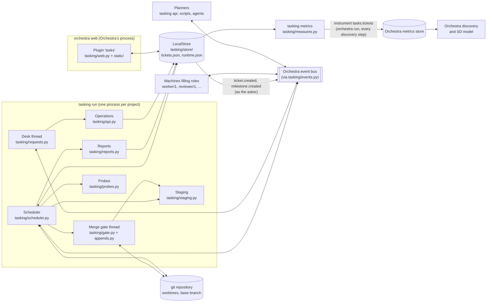
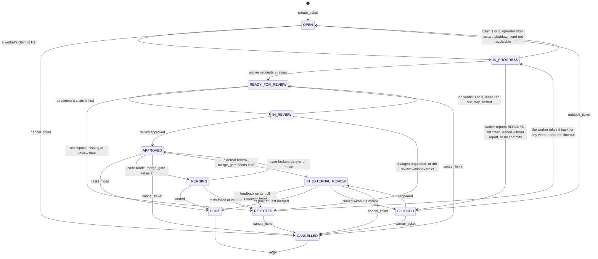
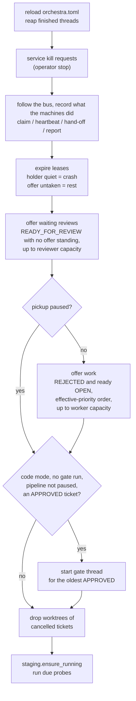
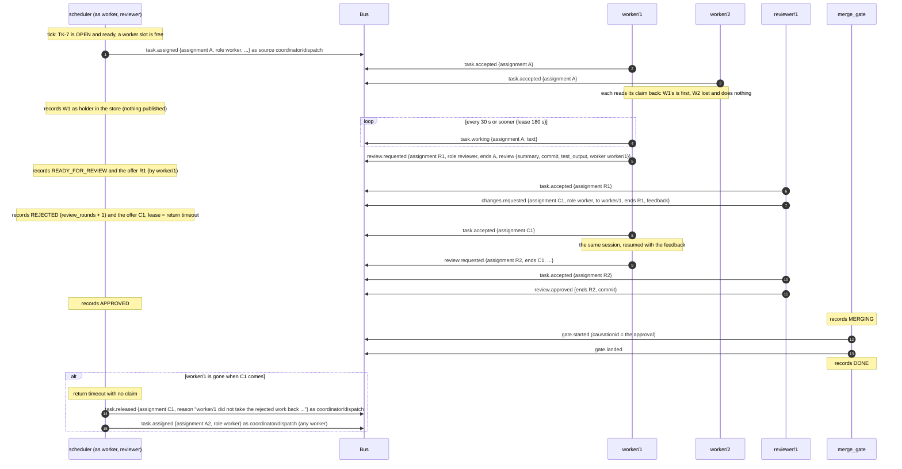
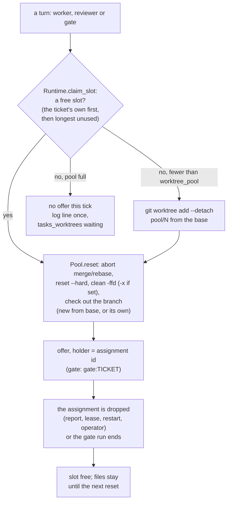
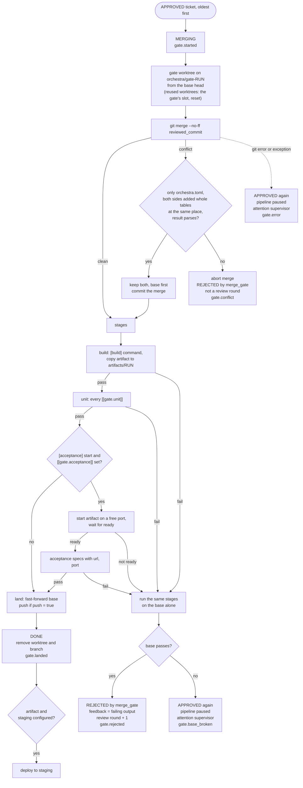
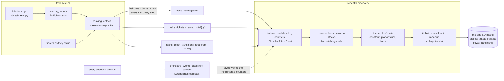

# Architecture of the task system

This document explains how the task system works and what a machine must do to work with it.
It is written for the owner and for engineers new to the code. `SPEC.md` is the design and
`AGENTS.md` the rules; this document describes the code as it is on `main` at the commit that last changed it and
names the module behind every statement. Where the two disagree, the code is what runs.

Contents:

1. [What it is](#1-what-it-is)
2. [Components](#2-components)
3. [Tickets and milestones](#3-tickets-and-milestones)
4. [The state machine](#4-the-state-machine)
5. [The scheduler](#5-the-scheduler)
6. [The assignment protocol](#6-the-assignment-protocol)
7. [What the end of a turn makes of a ticket](#7-what-the-end-of-a-turn-makes-of-a-ticket)
8. [The desk: requests on the bus](#8-the-desk-requests-on-the-bus)
9. [Attention](#9-attention)
10. [Work modes: tasks and code](#10-work-modes-tasks-and-code)
11. [The merge gate](#11-the-merge-gate)
12. [Staging and probes](#12-staging-and-probes)
13. [Metrics, and how they become stocks](#13-metrics-and-how-they-become-stocks)
14. [The plugin](#14-the-plugin)
15. [Event reference](#15-event-reference)
16. [Write a worker or a reviewer](#16-write-a-worker-or-a-reviewer)
17. [State on disk](#17-state-on-disk)
18. [Sharp edges](#18-sharp-edges)

## 1. What it is

The task system keeps **tickets** and **milestones**, decides which ticket is worked next and
by which **role** (`worker`, `reviewer`), **offers** waiting work on Orchestra's event bus, and
records what the machines do with it as they pass it between them. In code mode it also lands approved branches through a **merge
gate** and keeps a **staging** instance of the last build that passed.

It is an Orchestra plugin named `tasks`. Orchestra's web UI shows its pages, and
`orchestra run` keeps its scheduler running.

What it is not:

- It runs no machine besides the merge gate (`merge_gate`, code mode). Its scheduler is a
  daemon, not a machine: it stands in for each machine's own scheduling (the coordinator's
  dispatch, the leases of the worker's and the reviewer's turns, the gate, the answers to requests) and publishes only as the machine it acts for
  (section 6, "Who publishes what"). Whatever fills a role is another program that speaks the
  contract in section 6. In this repository that is a shell runner and a file checker
  (`demo/machines/`); elsewhere it can be anything, an AI agent included.
- It knows nothing about what a machine is made of. It reads a claim's `source` (who holds the
  work) and what the holder ended its turn with (a review requested, a verdict, a report).
  Nothing else.
- It is the record, not the hub (the owner's decision D17). The machines pass work between them
  directly; only the scheduler writes the record of it (`AGENTS.md` rule 1). A person or a planner
  changes tickets only by sending a request on the bus.

## 2. Components



| Module | What it does |
|---|---|
| `tasking/model.py` | `Ticket`, `Milestone`, `Note`, the `State` enum, `TRANSITIONS`, `RECOVERY`, readiness (`is_ready`) and effective priority (`effective_priorities`). Pure data and rules. |
| `tasking/store/` | The only code that reads or writes the JSON state. `tickets.py` holds tickets, milestones and notes; `runtime.py` holds what the scheduler holds while running; `files.py` does whole-file writes under one `fcntl` lock; `local.py` joins the halves as `LocalStore`. A change is recorded and counted (`metric_counts`), never published, except what a request made (`ticket.created`, `milestone.created`, as the asker). |
| `tasking/scheduler.py` | The loop: follows the bus, owns leases, makes offers (as `worker` or `reviewer`), starts the gate, keeps staging and probes going. It is no machine and announces nothing of itself. |
| `tasking/reports.py` | What the end of a turn (a review requested, a verdict, a report, or none) makes of a ticket. |
| `tasking/assignments.py` | The assignment contract: event names, `LEASE_S`, `HEARTBEAT_S`, the offer's `brief`. Its docstring table is the single source of truth for the five assignment events. |
| `tasking/requests.py` | Request names, the `Desk` that answers them, and `ask()` for callers. |
| `tasking/api.py` | The operations the desk applies (`create_ticket`, `cancel_ticket`, ...). |
| `tasking/events.py` | `Events`, a thin layer over `orchestra.events.Events`: `emit(type, src=..., cause=...)` publishes as `src` with the ticket or milestone as subject and `cause` as `causationid`; `read()` flattens `data` into the event dict. Refuses a publish as `task_scheduler`. Attention helper. |
| `tasking/gate.py`, `tasking/appends.py`, `tasking/git.py` | The merge gate, its one automatic conflict resolution, and thin `git` wrappers. |
| `tasking/staging.py`, `tasking/probes.py` | The staging instance and the `[[probes]]` checks. |
| `tasking/measures.py` | The counters kept in the record and the Prometheus text an instrument reads (`tasking metrics`, `/metrics`). |
| `tasking/config.py` | The task system's sections of `orchestra.toml`, and the state paths. |
| `tasking/web.py`, `tasking/static/` | The plugin: pages, every-page scripts, API routes, the scheduler's process and the instrument. |
| `tasking/cli.py`, `tasking/status.py` | The `tasking` command (`tasking metrics` included) and its one-screen status. |

Two processes touch the store: the scheduler (`tasking run`) and Orchestra's web server, which
loads the plugin. They share the store through the file lock. The web server writes only the
operator's controls (section 14).

## 3. Tickets and milestones

`tasking/model.py`, enforced by `tasking/store/tickets.py`.

A **milestone** has an id `M<n>`, a name, a description, an order and a status, `open` or
`closed`. Every ticket belongs to one. A milestone closes only when all its tickets are `DONE`
or `CANCELLED`. Closed is final: it never reopens and never receives tickets
(`close_milestone`, `create_ticket`, `update_ticket` refuse otherwise).

A **ticket** has an id `<ticket_prefix>-<n>` and these fields:

| Field | Set by | Meaning |
|---|---|---|
| `title`, `description`, `acceptance`, `objective`, `verification` | planner | what to do, how the reviewer tells it is done, why, how the gate's tests prove it |
| `priority` | planner | 1 is soonest; default 5 |
| `depends_on` | planner | ticket ids that must be `DONE` first; each must exist |
| `milestone_id` | planner | must name an open milestone |
| `state`, `state_since` | scheduler | see section 4 |
| `owner` | scheduler | the instance (`worker/1`) holding it; cleared when it leaves an active state |
| `branch`, `reviewed_commit` | scheduler | code mode only |
| `blocked_reason`, `feedback`, `rejected_by` | scheduler | what a planner reads, and what the next worker is told |
| `review_rounds`, `worker_turns`, `reviewer_rejections`, `gate_rejections` | scheduler | counters |
| `created_by` | scheduler | the `by` label of the request that made it |
| `version` | store | optimistic concurrency; every change adds one |

**Notes** are a log per ticket (`Note`: author, text, kind `note|review|gate|blocker|crash`).
The worker's summary, the reviewer's verdict, the gate's result, a blocker, a crash, a planner's
note all go here.

**Readiness** is derived (`is_ready`): a ticket is ready when it is `OPEN`, every dependency is
`DONE`, and its milestone is open.

**Effective priority** (`effective_priorities`) orders pickup. A ticket takes the best priority
of anything that depends on it, directly or not, so raising one ticket pulls its prerequisites
forward. Age then improves it by one level per `aging_days_per_level` days (default 2; 0 turns it
off). It never goes below 1.

## 4. The state machine

`State` and `TRANSITIONS` in `tasking/model.py`. The store refuses any move not in the table
(`check_transition`), and refuses `BLOCKED` without a `blocked_reason`.

| Group | State | Meaning |
|---|---|---|
| waiting | `OPEN` | waits for a worker |
| | `REJECTED` | sent back by a reviewer, the gate or the task system; waits for a worker, who gets `feedback` |
| | `READY_FOR_REVIEW` | waits for a reviewer |
| | `APPROVED` | approved; in code mode waits for the gate |
| | `IN_EXTERNAL_REVIEW` | external review: handed off for a pull request; waits for its people, checks and merge |
| | `BLOCKED` | waits for a planner's decision; `blocked_reason` says why |
| active | `IN_PROGRESS` | held by a worker instance |
| | `IN_REVIEW` | held by a reviewer instance |
| | `MERGING` | in a gate run (code mode) |
| terminal | `DONE` | approved, and in code mode landed |
| | `CANCELLED` | a planner cancelled it |

There are exactly these eleven states. Active states each have a waiting state they fall back to
(`RECOVERY`): `IN_PROGRESS` to `OPEN`, `IN_REVIEW` to `READY_FOR_REVIEW`, `MERGING` to
`APPROVED`.



Who makes each move, and the `by` label the move carries in the metrics (section 13):

| From | To | Cause | Code | `by` |
|---|---|---|---|---|
| `OPEN`, `REJECTED` | `IN_PROGRESS` | the first valid claim of a worker offer (the queue's, or changes requested of the worker); `worker_turns` + 1, `worker` = the holder | `Scheduler._accept` | the holder's machine name |
| `IN_PROGRESS` | `READY_FOR_REVIEW` | `review.requested`; in code mode the commit it names becomes `reviewed_commit` | `Reports.review_requested` | `worker` |
| `IN_PROGRESS` | `BLOCKED` | worker report `BLOCKED` with a reason | `Reports._worker` | `worker` |
| `IN_PROGRESS` | `BLOCKED` | third crash in a row; a turn that ended on purpose with no report; code mode, a review requested of nothing beyond the base | `Reports._block` | `worker` |
| `IN_PROGRESS` | `OPEN` | first or second crash (lease ran out, unusable report or review request, `failed: true`) | `Reports._worker` | `worker` |
| `IN_PROGRESS` | `OPEN` | operator stop, restart, shutdown, an outcome that threw | `Reports.back_to_waiting` | `worker` (whose turn it was) |
| `READY_FOR_REVIEW` | `IN_REVIEW` | the first valid claim of a review (the worker's request, or the queue's offer) | `Scheduler._accept` | the holder's machine name |
| `READY_FOR_REVIEW` | `REJECTED` | the folder or worktree is gone at review time; not a review round; `rejected_by = task_scheduler` | `Scheduler._assign` → `Reports.reject` | `reviewer` |
| `IN_REVIEW` | `APPROVED` | `review.approved` | `Reports.verdict` | `reviewer` |
| `IN_REVIEW` | `REJECTED` | `changes.requested`; `review_rounds` + 1 | `Reports.verdict` → `reject` | `reviewer` |
| `IN_REVIEW` | `REJECTED` | the fourth review in a row without a verdict; `rejected_by = task_scheduler` | `Reports.reject` | `reviewer` |
| `IN_REVIEW` | `READY_FOR_REVIEW` | no verdict (up to three times), lease ran out, operator stop, restart, shutdown | `Reports._no_verdict`, `back_to_waiting` | `reviewer` |
| `APPROVED` | `DONE` | tasks mode: right after `APPROVED` | `Reports.verdict` | `reviewer` |
| `APPROVED` | `MERGING` | the gate (`merge_gate`) takes the oldest approved ticket | `Scheduler._gate` | `merge_gate` |
| `MERGING` | `DONE` | the gate landed it | `run_gate` | `merge_gate` |
| `MERGING` | `REJECTED` | conflict (not a review round) or a failed stage (a review round); `rejected_by = merge_gate` | `run_gate.reject` | `merge_gate` |
| `MERGING` | `APPROVED` | base branch broken, gate error, or a restart during the run | `run_gate`, `recover` | `merge_gate` |
| `BLOCKED` | `OPEN` | `unblock_ticket` request | `api.handle` | the asker's machine (the request's source) |
| any waiting state | `CANCELLED` | `cancel_ticket` request; refused while active | `api.handle` | the asker's machine (the request's source) |
| `APPROVED` | `IN_EXTERNAL_REVIEW` | external review: the gate hands the branch off (`gate.handed_off`) | `External.hand_off` | `merge_gate` |
| `IN_EXTERNAL_REVIEW` | `REJECTED` | feedback on the pull request's head, gathered for `settle`; `review_rounds` + 1, `pull_rejections` + 1 | `External._engage` → `send_back` | who gave it (`person.<login>`, a bot) |
| `IN_EXTERNAL_REVIEW` | `BLOCKED` | `github.pr.closed` | `External._closed` | who closed it |
| `BLOCKED` | `IN_EXTERNAL_REVIEW` | `github.pr.reopened` of the pull request that closed it | `External._reopened` | who reopened it |
| any waiting state | `DONE` | `github.pr.merged` (an active ticket's holder is released first) | `External._merged` | who merged it |

`by` is never `task_scheduler`: a move the scheduler records names the machine whose act or
responsibility it was, and the store refuses one recorded by the scheduler without a `by`
(`Tickets.transition`). A restart that sends an active ticket back counts it for the machine whose
turn it was (`Reports.ROLE_OF`: `IN_PROGRESS` worker, `IN_REVIEW` reviewer, `MERGING` merge_gate).
A ticket's `rejected_by` still says `task_scheduler` when the task system's rules sent it back, for
the worker to read.

Two things change no state at all: an offer nobody claims, and a heartbeat. No move is published:
the record keeps it (the ticket's `caused_by` names the event that caused it), the queries and the
Tickets page read it, and `tasks_ticket_transitions_total` counts it (section 13).

`TRANSITIONS` allows `CANCELLED` only from a waiting state, so the store itself refuses to
cancel an active ticket; `cancel_ticket` checks first to say why ("wait for it to settle").

## 5. The scheduler

`tasking/scheduler.py`, run as `tasking run`.

### Starting and stopping

`orchestra run` starts the scheduler because the plugin declares it (section 14). It is
`tasking run --wait`. There is one scheduler per project. A second one exits, naming the pid of
the first; with `--wait` it waits for the first to stop and then takes over.

On start (`Scheduler.recover`, then `run`):

1. Every assignment in the runtime record gets `task.released` ("the task system restarted").
   A held one is settled: its ticket goes back to the waiting state before it, with a note.
   Every ticket still active goes back too. This is the "no zombies" rule.
2. The record of offers nobody took is cleared, so they go out fresh.
3. Gate runs left `running` are marked `aborted`; gate worktrees and `orchestra/gate-*`
   branches are removed. With reused worktrees, the gate's hold on the pool is dropped and a
   pool worktree left on a gate branch is detached first, so the branch can go.
4. The desk thread starts. Then the runtime record names this pid. The scheduler announces
   nothing of itself: it is no machine (`Scheduler.announce`). Dispatch announces itself as
   `coordinator/dispatch` (`mode: continuous`, `kind: program`, `listens_for: [gate.conflict,
   gate.rejected, task.released, ticket.created]`, its log; no package: the coordinator is
   whoever fills that role, and an instance of its own erases nothing the agent coordinator
   announced). In code mode the gate announces itself, as `merge_gate`
   (`package: tasks`, `mode: continuous`, `kind: program`, `listens_for: [review.approved]`,
   `log`).
5. If the pipeline is still paused, the supervisor role gets attention (as `merge_gate`).
6. If staging was deployed and its process is gone, it is started again.

On SIGTERM or SIGINT, the loop ends. A running gate run finishes first. Then every assignment is released ("the task system shut down"),
and the pid is cleared. Nothing says the scheduler stopped: the runtime record and the Core page
(the process `tasks.scheduler`) do.

### The tick

Every `[tasks] tick` (3 s by default) the scheduler runs `Scheduler.tick`:



The tick writes no metrics. With reused worktrees it keeps the number of turns waiting for a
worktree in the runtime record, for the instrument to read (section 13).

Points worth knowing:

- **Reviews first.** Finished work moves on before new work starts. With reused worktrees the
  gate goes first of all: it is started before the offers, so its claim on the pool wins. Pausing pickup stops worker
  offers only; reviews still go out.
- **Capacity counts offers, not just held work.** Every assignment record counts against its
  role, claimed or not, the offers machines make each other included (a review requested
  counts against the reviewers). An offer nobody answers holds a slot until its lease runs out.
  The scheduler limits only its own offers: a worker's review request is recorded even when the
  reviewers are full.
- **Capacity has three layers** (`store/runtime.py`, `Runtime.capacity`): the operator's
  ceiling from the web UI if set, else `[tasks] workers` / `reviewers` from `orchestra.toml`
  (default 1 each), and under that a planner's dial (`set_capacity`). The effective number is
  the dial capped by the ceiling. All are read every tick.
- **The bus is read once per tick.** The record lags the machines by up to `tick` seconds; the
  machines do not wait for it (a claimant reads its own claim back), so a whole review can be
  done before the record has the request.
- One bad event or one bad tick is logged and skipped; the loop never stops on an exception.

### Leases and offers nobody took

`LEASE_S` is 180 s and fixed. `HEARTBEAT_S` is 30 s. Every offer carries `lease_s`.

- A **claimed** assignment whose lease runs out (no `task.working` or end for 180 s) is
  released and settled as a crash: `Reports.apply(a, None, "", failed=True)`. This holds for a
  turn a machine offered as for one the queue offered: the scheduler saw the claim.
- An **addressed** offer (rejected work `to` the worker that did it) is released when its
  addressee does not claim it within `[tasks] return_timeout` (60 s): a note says why, and the
  queue (dispatch, as `coordinator/dispatch`) offers the ticket to any worker at once (`untaken.returned` keeps it from being addressed
  again until the ticket changes).
- An **unaccepted** offer whose lease runs out is released and dropped. Nothing about the
  ticket changes. The scheduler records it in `untaken` and rests that (ticket, role) pair:
  60 s (`AGAIN_FIRST_S`) after the first miss, doubling per miss, up to 15 min (`AGAIN_MAX_S`).
- The rest is cut short when the ticket's `version` changes (a planner edited it; the count
  starts over), or when any machine publishes `orchestra.machine.started` with `task.assigned`
  in its `listens_for`.
- An unaccepted offer whose ticket left the offered state (cancelled meanwhile) is released.
- The Tasks panel shows the untaken record as "offered, not taken".

## 6. The assignment protocol

The tables in the docstring of `tasking/assignments.py` are the contract; `SPEC.md` section 3 is
the design (the owner's decision D17: the task system is the record, not the hub). This section
explains it. The `assignment` id (`<ticket>.<role>.<8 hex>`) names one turn of work and is made by
whoever offers the turn. The `source` is who speaks: `<machine>/<instance>` for a machine,
`coordinator/dispatch` for the queue (dispatch is the coordinator's), `worker` or `reviewer` (no
instance) for a held turn of that role taken back, `merge_gate` for the gate. The
scheduler is never a source (`task_scheduler` is refused by `tasking/events.py`): the owner's
decision of 2026-10-27 is that it is no machine but one daemon standing in for each machine's own
scheduling, an implementation detail of the task system that Orchestra's Machines page, event
graph and hand-offs never show.

### Who speaks

Work passes directly between the machines that do it. The scheduler reads every event and
records it; it publishes only an act no machine's own process already announced, as the machine
whose responsibility it implements:

| Step | Who publishes | Event |
|---|---|---|
| waiting work is offered from the queue | dispatch: `coordinator/dispatch` | `task.assigned` (to a role; or `to` the worker that did rejected work) |
| a machine takes an offer | the instance | `task.accepted` |
| the holder is still at it | the holder | `task.working` |
| a worker has finished | the worker | `review.requested` (offers the review) |
| a reviewer rejects | the reviewer | `changes.requested` (offers the rework `to` the worker that did it) |
| a reviewer approves | the reviewer | `review.approved` (for the gate) |
| the work passes to no machine | the holder | `task.reported` (a worker's BLOCKED, or no report) |
| the gate takes approved code | `merge_gate` | `gate.*` (`gate.started` names the approval as `causationid`) |
| an offer nobody claimed is withdrawn | dispatch: `coordinator/dispatch` | `task.released` |
| a held turn is taken back | the role: `worker` or `reviewer` | `task.released` |
| the record of a machine's step | nobody: recorded in the store only | none |

### Who publishes what

Everything the scheduler publishes, and as whom. It is the same table as SPEC.md section 3.

| What the scheduler does | Published as (source) | Events |
|---|---|---|
| creates a ticket or milestone on a planner's request | the asker (the request's source); `causationid` = the request | `ticket.created`, `milestone.created` |
| answers a request or query | the asker; `causationid` = the request; subject = the ticket for a change, none for a query | `request.done`, `request.refused` |
| applies any other request (update, note, cancel, unblock, milestone change or close, capacity, resume the pipeline) | nothing beyond the answer | none |
| offers waiting work to a worker from the queue: a ticket's first offer from `OPEN`, an offer again after one nobody took or a held turn taken back, rework that reached the queue (also rejected work addressed `to` the worker that did it, after a gate rejection or a restart) | `coordinator/dispatch`: choosing what is offered next (readiness, priority, capacity, when it goes out again) is dispatch, the coordinator's | `task.assigned` |
| offers waiting reviews from the queue: a review nobody took, a reviewer gone, after a restart | `coordinator/dispatch`, for the same reason: which waiting review goes to the reviewers' capacity is dispatch. A worker's `review.requested` stays the worker's own hand-off to the reviewers; the queue offers only what that hand-off did not place | `task.assigned` |
| withdraws an offer nobody claimed: its lease ran out, an addressed one was not taken within the return timeout, the ticket moved on, the operator's stop, a restart or shutdown | `coordinator/dispatch`, whoever made the offer (the queue, a worker's `review.requested`, a reviewer's `changes.requested`): nobody holds it, and it goes back into dispatch's queue, so no role is drawn as having had it | `task.released` |
| takes a held turn back: a silent holder, the operator's stop, a restart or shutdown; answers a claim it cannot record | the role whose turn it was (`worker`, `reviewer`): the turn is that role's, its instance is the one that stops, and the map reads worker → coordinator (`task.released`) when dispatch offers it again; `instance` in the data when addressed to one | `task.released` |
| says at each start what makes dispatch act | `coordinator/dispatch` {mode: continuous, kind: program, listens_for: [gate.conflict, gate.rejected, task.released, ticket.created], log} | `orchestra.machine.started` |
| records a step another machine announced (a claim, a heartbeat, `review.requested`, `changes.requested`, `review.approved`, `task.reported`) | nothing: recorded in the store only | none |
| runs the gate | `merge_gate` (a machine: it does work of its own, merging) | `gate.started` (`causationid` = the approval), `gate.landed`, `gate.rejected`, `gate.conflict`, `gate.error`, `gate.base_broken`; in code mode its announcement {package: tasks, mode: continuous, kind: program, listens_for: [review.approved], log} |
| external review: hands an approved branch off | `merge_gate`; `causationid` = the approval | `gate.handed_off` |
| external review: sends the work back after feedback on its pull request | whoever gave the first of it, as the bridge named them; `causationid` = that bridge event; not taken within the return timeout, withdrawn and offered to any worker as `coordinator/dispatch` | `changes.requested` (`to` the worker that did it) |
| external review: asks a planner about a ticket sent back by its pull request at a multiple of the threshold | `merge_gate` | `task.attention_needed` |
| external review: asks a planner about a pull request closed unmerged | `merge_gate` | `task.attention_needed` |
| pauses the pipeline | `merge_gate` | `pipeline.paused` |
| deploys or restarts staging | `merge_gate` | `staging.deployed`, `staging.failed`, `staging.restarted` |
| asks a planner about a ticket blocked by the worker's report, a worker turn that keeps failing, nothing beyond the base | `worker` (whose work is stuck) | `task.attention_needed` |
| asks a planner about a ticket rejected at a multiple of the threshold by reviews (or by reviews that kept ending without a verdict) | `reviewer` | `task.attention_needed` |
| asks a planner about gate rejections at the threshold, the base broken, a gate error, a landed `orchestra.toml` the root did not follow, the pipeline still paused after a restart, staging failed | `merge_gate` | `task.attention_needed` |
| runs the `[[probes]]` | `probes` (the condition checks; whether they should become instruments is open: Orchestra's `docs/roadmap/story-placement.md` §7 item 2) | `probe.failed`, `probe.recovered` |
| the operator's controls (web) | `task_web` | `capacity.changed`, `pickup.paused`/`resumed`, `kill.requested` |

No echoes: `ticket.transitioned`, `ticket.note_added`, `ticket.updated`, `milestone.updated`,
`milestone.closed` and `scheduler.stopped` no longer exist, nor `capacity.changed` and
`pipeline.resumed` caused by a planner's request. Each restated an act some machine had already
announced (a claim, `review.requested`, `changes.requested`, `review.approved`, `task.reported`,
`gate.*`, `task.released`, a request answered by `request.done`).

### The events

| Event | From | Data | The scheduler reads |
|---|---|---|---|
| `task.assigned` | dispatch, as `coordinator/dispatch` | the offer fields: `assignment`, `role`, `ticket`, `workspace`, `branch` and `base` (null in tasks mode), `lease_s`, `brief`, `unit_command` (code), a reviewer's `review` {`summary`, `commit`, `test_output`, `worker`}, `to` | (it sends this) |
| `review.requested` | the worker holding the work | the offer fields for the reviewer's turn, `ends` | `ends`, `assignment`, `ticket`, `role`, `workspace`, `review.summary`, `review.commit`, `review.test_output`, `source` |
| `changes.requested` | the reviewer holding the review | the offer fields for the worker's turn (`brief.feedback`, `brief.rejected_by` set), `to`, `ends`, `summary`, `feedback`, `commit` | `ends`, `assignment`, `ticket`, `role`, `workspace`, `to`, `summary`, `feedback`, `commit`, `source` |
| `task.accepted` | the instance | `assignment`, `ticket`, `role`, optional `instance` | `assignment`, `instance`, `source` |
| `task.working` | the holder | `assignment`, `ticket`, `role`, optional `text` | `assignment`, `text` (last 200 chars, shown on the Tasks panel), `source` |
| `review.approved` | the reviewer holding the review | `ends`, `ticket`, `role`, `summary`, `commit` | `ends`, `summary`, `commit`, `source` |
| `task.reported` | the holder | `assignment`, `ticket`, `role`, `report`, `failed`, `text`, `commit` | `assignment`, `report`, `failed`, `text`, `source` |
| `task.released` | an offer nobody claimed: dispatch, as `coordinator/dispatch`; a held turn: its role, as `worker` or `reviewer` | `assignment`, `ticket`, `role`, `reason`; `instance` when addressed to one instance | (it sends this) |

`brief` holds the ticket's `id`, `title`, `objective`, `description`, `acceptance`,
`verification`, `feedback`, `rejected_by`, `review_rounds`, `priority`, `depends_on`, `branch`
and `worker_turns` (`assignments.brief`). In an offer, `worker_turns` and `branch` are already
the values the ticket will have once a worker takes it. Every event of a turn names the offer
that opened it as its CloudEvents `causationid`.

### Rules the scheduler applies (`Scheduler._follow`, `_claim`, `_accept`, `_end`, `_hand_over`)

- **The bus's order decides who holds a turn.** The first valid claim of an offer holds it:
  `instance`, if sent, equals `source`, and an offer addressed `to` an instance is claimed by that
  instance. The claimant reads its claim back from the bus to know; the scheduler records the
  same holder in the store (the ticket's `owner`, `caused_by` the claim; nothing is published)
  and says nothing to a loser (`assignments.holder`, the rule both sides apply).
- **A claim naming another instance than its source** gets `task.released` naming the
  `source`, and the offer stays open. A claim of an offer addressed to someone else changes
  nothing.
- **A claim of an assignment not held** (released, from before a restart, an offer the record
  could not stand behind) gets `task.released` naming the instance, reason "not held". A claim of
  a turn its holder lately ended (`settled`, the last 1000) gets nothing: it lost the race.
- **A claim whose ticket can no longer move** (cancelled meanwhile) gets `task.released` naming
  the instance, and the offer is dropped.
- **Heartbeats and ends from anyone but the holder are ignored.** So are those for an assignment
  not held (a line in the log, except for a heartbeat).
- **An end settles the turn.** `task.reported` and `review.approved` are applied (section 7),
  then the assignment is dropped. `review.requested` and `changes.requested` are applied, then the
  turn they offer is recorded in place of the one they end (`Runtime.hand_over`, which passes a
  pool worktree's hold with it), with the workspace of the turn that ended: an offer naming
  another ticket, role or workspace, no id, or (rejected work) no `to`, is not recorded, and the
  ticket waits for the queue.
- The record reads the bus behind the machines: by the time it records a review request, the
  reviewer may have rejected it and the worker committed again. So a commit is checked to be on
  the branch, never to be its head.

### Release reasons

| Reason (text in `reason`) | Addressed to one `instance`? | Ticket effect |
|---|---|---|
| nobody filled the role within 180 s | no | none; the offer rests (section 5) |
| `<instance>` did not take the rejected work back within N s (gone, or busy); offered to any worker | no | a note says the same; offered to any worker at once |
| no word from `<instance>` for 180 s | no | crash (section 7) |
| the operator stopped it | no | back to waiting, not counted |
| the acceptance claimed instance `<claimed>`, but an instance must be the event's source | yes (the event's `source`) | none; offer stays open |
| not held (released, already settled, or never valid) | yes | none |
| the ticket cannot be worked/reviewed now | yes | none; offer dropped |
| the ticket is `<state>` | no | none (it moved on before anyone claimed it) |
| the task system restarted / shut down | no | back to waiting, not counted |

### A ticket worked, rejected once, reworked by the same worker and landed



Orchestra's event map (hand-offs inferred from who acts next on a subject, named by the event
the receiver listens for) draws this, with the planner that asked for TK-7, as `planner →
coordinator (via ticket.created) → worker (task.assigned) → reviewer (review.requested) → worker
(changes.requested) → reviewer → merge_gate (review.approved)`, with nothing in between: the first
offer is dispatch's, the coordinator's, and dispatch's announcement (section 5) names
`ticket.created` as what it listens for. After a gate rejection it draws `merge_gate →
coordinator` via `gate.rejected`, then `coordinator → worker`; after a held turn is taken back,
`worker → coordinator` via `task.released`.
`tests/e2e/test_handoffs_e2e.py` checks this, and that no event has the source `task_scheduler`.

## 7. What the end of a turn makes of a ticket

`tasking/reports.py`.

**Usable reports** (`unusable`). A `task.reported` is for work that passes to no machine: a
worker's `{state: "BLOCKED", blocked_reason: "..."}`, or a null `report` (the turn ended without
one). Anything else, a `READY_FOR_REVIEW` or a verdict included (those pass on directly), is
treated as no report with `failed: true`, and the reason becomes the machine's last words.

Everything a machine did is recorded with its event as the cause (`cause=ev`): the ticket keeps
its id as `caused_by`. Nothing is published for it: the machine announced it itself. Each move is
counted `by` the machine whose act or responsibility it was (section 4), and attention is
published as that machine (section 9).

**Worker outcomes** (`Reports._worker`), only while the ticket is `IN_PROGRESS`:

| What came back | Result |
|---|---|
| `review.requested`, tasks mode (`review_requested`) | note with the summary; `READY_FOR_REVIEW`; `feedback` cleared |
| `review.requested`, code mode | the commit must be on the branch (else no report); if it is not beyond the base, `BLOCKED`; else `READY_FOR_REVIEW` with `reviewed_commit` = the commit and `test_output` kept |
| `BLOCKED` with a reason | note; `BLOCKED`; attention to `coordinator` |
| no report, `failed: true` (quiet, lease ran out, unusable) | crash note; `OPEN`, offered again; the workspace is kept. The third crash in a row is `BLOCKED` (`CRASH_BUDGET` = 2) |
| no report, `failed: false` | `BLOCKED` at once: it ended on purpose without a report |

"In a row" means trailing crash notes by the worker; any other note (a report, an unblock)
resets the count.

**Reviewer outcomes** (`Reports.verdict`, `_no_verdict`), only while the ticket is `IN_REVIEW`:

| What came back | Result |
|---|---|
| `review.approved` | note; `APPROVED`; in tasks mode `DONE` straight after |
| `changes.requested` | note; `REJECTED` with `feedback` (or the summary), `rejected_by = reviewer`, `review_rounds` + 1; the rework offer `to` the worker is recorded |
| no verdict (quiet, a report, or a `commit` that differs from `reviewed_commit`) | crash note; `READY_FOR_REVIEW` to be reviewed again (from the queue). The fourth in a row is `REJECTED` with `rejected_by = task_scheduler`, counted `by` `reviewer` (`NO_VERDICT_BUDGET` = 3) |

On a counted rejection, when `review_rounds` is a multiple of
`review_rounds_before_escalation` (default 3), the `coordinator` role gets attention. Every
rejection, the gate's included, goes through `reports.send_back`, which counts the round and
escalates, so the two paths cannot drift. Nothing
fails automatically.

**Not counted at all:** an operator stop, a restart, a shutdown (`back_to_waiting`), and an
outcome that throws inside `_settle` or `_hand_over` (back to waiting, with a note).

## 8. The desk: requests on the bus

`tasking/requests.py` and `tasking/api.py`.

A planner (a person's script, `tasking api`, another package's agent) changes tickets only by
asking. The desk is a thread in the scheduler's process. It polls the bus every 0.5 s, applies
each request with `api.handle`, and answers.

A request carries `request` (an id), `args` and `by`. `by` is a label the asker picks. It names
the author: it becomes `created_by` and the note author. The metrics' `by` is the machine of the
request's source (its part before `/`; `tasking api` publishes with `source` = `by`, so the two
agree). A change without `by` is refused. The task system checks the rules of tickets and
milestones, not who asks.

| Event type | `op` | `args` |
|---|---|---|
| `task.requested` | `create_ticket` | `title`, `milestone_id`, and optional `description`, `acceptance`, `objective`, `verification`, `priority`, `depends_on` |
| `task.change_requested` | `update_ticket` | `id`, and any of `title`, `description`, `acceptance`, `objective`, `verification`, `priority`, `milestone_id`, `depends_on` |
| `task.note_requested` | `add_note` | `id`, `text` |
| `task.cancel_requested` | `cancel_ticket` | `id`, optional `reason` (refused while active or terminal) |
| `task.unblock_requested` | `unblock_ticket` | `id`, optional `note` (refused unless `BLOCKED`; the note becomes `feedback`) |
| `milestone.requested` | `create_milestone` | `name`, optional `description` |
| `milestone.change_requested` | `update_milestone` | `id`, any of `name`, `description`, `order` |
| `milestone.close_requested` | `close_milestone` | `id` |
| `capacity.change_requested` | `set_capacity` | `workers`, `reviewers`, `note` (the planner's dial) |
| `pipeline.resume_requested` | `resume_pipeline` | none |
| `task.query_requested` | in `data.op`: `list_tickets` (`state`, `milestone_id`), `get_ticket` (`id`), `project_status`, `list_milestones`, `get_capacity`, `snapshot`, `list_gate_runs`, `get_gate_run` (`id`), `get_staging_status` | as listed |

Answers:

- `request.done` {`request`, `result`}
- `request.refused` {`request`, `error`}

Both are published as the asker (the request's `source`), with the request's id as
`causationid`: the desk stands in for the asker's own request handling and is no machine. The
subject is the `id` or `milestone_id` in `args`, or the created ticket's id; a query's answer has
none. `create_ticket` and `create_milestone` also publish `ticket.created` or `milestone.created`
as the asker, caused by the request, since the new id is news. Every other change (an update, a
note, a cancel, an unblock, a milestone's change or close, `set_capacity`, `resume_pipeline`) is
answered by `request.done` alone (`set_capacity` and `set_pipeline` are called with
`announce=False`): the request already said what it asks.

**Restarts.** The desk saves its bus offset, and the ids it has answered since that offset, in
the runtime record after every answer. A new desk reads on from there, so a request sent while
no scheduler ran is still answered, and none is answered twice. A request older than
`RESUME_S` (60 s, twice the 30 s `ask` waits) when read is refused, not applied: its asker gave
up long ago.

`ask(events, op, args, by)` sends one request and waits up to 30 s for the answer. `tasking api
--as <by> <op> --args '<json>'` is the same from the shell; it publishes with `source` = `by`.

## 9. Attention

`Events.attention` publishes `task.attention_needed` {`to`, `reason`, `ticket`?}, as the machine
whose work is stuck or whose responsibility raised it (`src`). `to` is a planner role name,
`coordinator` or `supervisor`. The task system runs no planner. Nothing hears these unless a
planner machine listens.

| When | `to` | Published as | Code |
|---|---|---|---|
| a worker reports `BLOCKED` | `coordinator` | `worker` | `Reports._worker` |
| the task system blocks a ticket (crashes, no report, no commits) | `coordinator` | `worker` | `Reports._block` |
| `review_rounds` reaches a multiple of the threshold on a counted rejection by reviews (a reviewer's, or reviews that kept ending without a verdict) | `coordinator` | `reviewer` | `reports.send_back` (from `Reports.reject`) |
| the same, by the gate | `coordinator` | `merge_gate` | `reports.send_back` (from `run_gate.reject`) |
| a landing changed `orchestra.toml` but the repository root did not follow | `coordinator` | `merge_gate` | `run_gate` |
| the base branch fails the gate; the pipeline pauses | `supervisor` | `merge_gate` | `run_gate` |
| the gate hit an error; the pipeline pauses | `supervisor` | `merge_gate` | `run_gate.error` |
| the pipeline is still paused when the scheduler starts | `supervisor` | `merge_gate` | `Scheduler.run` |
| a staging deploy failed and was rolled back | `supervisor` | `merge_gate` | `Staging._deploy` |
| staging died or stopped answering, and the first restart failed | `supervisor` | `merge_gate` | `Staging._recover` |

Routine news is not attention. It is in `ticket.created`, `milestone.created`, `gate.landed` and
`request.done`, and every move is in the record.

## 10. Work modes: tasks and code

`[project] work` chooses what a ticket's workspace is.

**`tasks`** (the default). The workspace is a folder, `<state>/workspaces/<ticket>/`, made at
the first worker offer and kept for the reviewer and later turns. It holds nothing of the
repository. Nothing is merged. Approved means done. The result is whatever the worker left in
the folder, plus its summary. Before the queue offers a review, the scheduler checks the folder
still exists; if not, the ticket is rejected without a review round.

**`code`**. The workspace is a git worktree at `<state>/worktrees/<ticket>/` on the branch
`orchestra/<ticket>-<slug>`, made from `base_branch` and reused by every turn
(`Scheduler._worktree`). Every offer names the branch, the `base` and the first `[[gate.unit]]`
command as `unit_command`. The worker commits, runs `unit_command` on the commit, and puts the
commit and the output in its review request (`review.commit`, `review.test_output`); the record
keeps them (`reviewed_commit`, `test_output`) for a review the queue offers later. The task system
runs no tests before a review: it verifies at the gate. A cancelled ticket's worktree is removed by the next tick; a
landed ticket's worktree and branch are removed by the gate.

**Reused worktrees** (`[tasks] reuse_worktrees = true`, code mode; `tasking/pool.py`,
`Runtime.claim_slot`). When one checkout costs gigabytes, a worktree per ticket is too many. The
pool keeps at most `worktree_pool` worktrees at `<state>/pool/<n>/` and lends one to each turn
the queue offers (a worker's, a reviewer's) and to each gate run. A turn one machine offers
another directly gets the worktree the work is in: `Runtime.hand_over` passes the hold.



- **Who holds a slot** is the runtime record: `pool[n].holder` is an assignment id or
  `gate:<ticket>`. A slot whose holder is an assignment no longer in the record is free, so every
  path that drops an assignment frees its worktree without a second step, and a crash cannot
  leak one. A gate's hold is released when its thread ends and on restart.
- **All claims happen in the tick thread** (the gate's too, before it starts its thread), so two
  claims never race; releases may come from any thread, under the store's lock.
- **Between turns the work is on the branch.** A ticket holds no worktree while it waits. Its
  reviewer gets a slot reset to its branch; if the branch is gone, the ticket is rejected without
  a review round, as a missing worktree is without the pool.
- **A branch is checked out in one worktree at a time.** Before checking one out, `Pool.reset`
  detaches any other of the task system's worktrees that has it and that no assignment works in;
  the gate does the same before deleting a landed branch.
- **The gate** resets its slot to `orchestra/gate-RUN`, and for a base check to
  `orchestra/gate-RUN-base` in the same slot; at the end it detaches the slot and deletes both
  branches. Nothing is made under `gate/`.
- **Pool full** is back-pressure, like capacity: the offer waits, the log says so once per ticket
  and role, and `tasks_worktrees{state="waiting"}` counts the waits. No attention is asked.

Machines never merge, push, or touch the base branch (`AGENTS.md` rule 5). Only the gate lands
code, and only a landing deploys staging.

## 11. The merge gate

`tasking/gate.py`, `tasking/appends.py`, `tasking/git.py`. Code mode only.

The scheduler starts at most one gate run at a time, for the `APPROVED` ticket that has been
approved longest, unless the pipeline is paused. It moves the ticket to `MERGING`, then calls
`run_gate` in a thread. Each run lands one ticket, so a failure is that ticket's unless the
base itself fails.



Details:

- **Stages** (`_stages`). `[build]` runs if `command` is set; the newest file matching
  `artifact` is copied to `<state>/artifacts/<run>/`. Then every `[[gate.unit]]` spec, stopping
  at the first failure. Then, if `[acceptance] start` and `[[gate.acceptance]]` are both set,
  the artifact is started (`{python}` is a venv with the artifact installed, `{port}` a free
  port) and the acceptance specs run with `{url}`, `{port}`, `{artifact}`, `{python}`. Exit 0
  passes; pytest's exit 5 ("no tests collected") also passes. Each spec has a timeout
  (`[gate] timeout`, 900 s by default). Logs go to `<state>/logs/<run>/<stage>-<spec>.log`.
- **The `orchestra.toml` resolver** (`appends.resolve_appends`). Git cannot order two
  additions at one spot, for example two tickets that each append a `[[collect]]` or
  `[[machines]]` entry. The gate keeps both, the base's first, but only when: `orchestra.toml`
  is the only conflicted file; in every conflict region the common ancestor is empty; each
  side's addition is whole tables (or both sides began under the same `[[...]]` header that git
  took as context, and each side gets its own copy of it); and the result parses as TOML. The
  run's summary says so. Anything else is a conflict.
- **A conflict** goes back to the worker with git's output as feedback. It does not count as a
  review round, so it never triggers escalation. `gate_rejections` + 1.
- **A failed stage** checks the base alone in a second worktree. If the base passes, the ticket
  is `REJECTED` with the failing output; this counts as a review round (and escalates at the
  threshold, like a reviewer's rejection) and `gate_rejections` + 1.
  If the base fails too, the ticket goes back to `APPROVED`, the pipeline pauses, and the
  supervisor is told. Nothing is blamed on the ticket.
- **Landing** (`Git.land`). The base ref must not have moved since the run started. If the
  repository root has the base branch checked out and clean, it is fast-forwarded there, so the
  root's files follow. An untracked file at a path the landing adds stops it with a gate error.
  If the root has another branch checked out, only the ref moves (`git update-ref`); if the
  landing changed `orchestra.toml`, the summary says so and the coordinator is told, because
  Orchestra's launcher reads that file from the root.
- **A gate error** (git failed, anything threw) puts the ticket back to `APPROVED` and pauses
  the pipeline. `pipeline.resume_requested` resumes it.
- Gate runs are kept in the runtime record (`gate_runs`) with their stages, status
  (`running`, `landed`, `conflict`, `rejected`, `base_broken`, `error`, `aborted`) and summary.

### External review

`tasking/external.py`, with `[gate] mode = "external"` in code mode. The gate lands nothing; it
hands the approved branch off (`IN_EXTERNAL_REVIEW`, `gate.handed_off`), the owner pushes it and
opens the pull request, and the ticket follows what orchestra-bridges' pull-request bridge
publishes about it. SPEC.md section 5 has the rules; this is the round trip.

```mermaid
sequenceDiagram
    autonumber
    participant W as worker/1
    participant R as reviewer
    participant G as merge_gate
    participant O as Owner
    participant B as bridges.github_prs
    participant T as Scheduler (External)
    W->>R: review.requested
    R->>G: review.approved
    G->>O: gate.handed_off (branch, commit)
    O->>B: push the branch, open the pull request (on GitHub)
    B->>T: github.pr.opened (branch: linked)
    B->>T: github.pr.review_submitted changes_requested, review_commented ×2 (head = the handed-off commit)
    Note over T: gathered until settle; REJECTED, counted by person.alice
    T->>W: changes.requested as person.alice, to worker/1 (feedback: files and lines, no text)
    W->>R: review.requested (the same branch, a new commit)
    R->>G: review.approved
    G->>O: gate.handed_off (the new commit)
    O->>B: push
    B->>T: github.pr.pushed, then github.pr.merged
    Note over T: DONE, worktree and branch removed
```

`External.follow` runs every tick after `_follow`: it reads the bus from its own offset (kept in
`runtime.json` with the ids it applied lately and the feedback it is gathering), applies each
`github.pr.*` event of the configured repository to the ticket linked to it (by `pull`, else by
the head branch), and re-engages the worker for each ticket whose feedback has settled. The
offer is made by `Scheduler._assign` (as `_offer_back`), so it is recorded, leased (the return
timeout) and claimed exactly as a reviewer's `changes.requested`; `_follow` skips the event itself,
which ends no turn. If that worker does not take it back within the return timeout, `_release`
withdraws it as `coordinator/dispatch` (nobody claimed it) and the next tick's `_assign` offers it
to any worker as `coordinator/dispatch`: on Orchestra's map, the pull request's reviewer → worker,
then worker → coordinator → worker, as after any rejection. Only the turn back to the worker that
did it is published as the pull request's reviewer; every offer from the queue is dispatch's. A merge while the worker has the work back goes through `Scheduler._withdraw`
(the operator's stop, without counting) before `DONE`.

### Stacked branches

`tasking/stacks.py` (the policy) over `tasking/spice.py` (a thin git-spice wrapper), with
`[gate] stacking = "git-spice"` in code mode; SPEC section 5 has the rules. The scheduler calls it
at four points and nowhere else: `Scheduler._ready` (a ticket with one unlanded dependency whose
work stands for review is ready), `_worktree` (`Stacks.prepare` makes a new branch from the parent's
head and tracks it, before the worktree or the pool's reset checks it out; if the parent moved on
since the queue looked, say the gate took it, the offer is not made, rather than a branch from a
base that misses it), `_assign` (the offer's `base` is the parent's branch), `_start_gate` (only a
ticket that is not `stacked_on` anything goes to the gate), and once a tick `Stacks.tick`, after the
bus is followed and before any offer, restacks what moved. External review's hand-off takes its
`base` from `Stacks.base`, and its merge keeps the bridge's `merge_commit` as `merged_as`.

git-spice records the tree; the record keeps `stacked_on`. The two agree because the task system
makes every change to the tree: `prepare` tracks, the landing (or the merge's `_drop`) deletes the
parent's branch and git-spice, on its next command, moves the branches on it onto the base keeping
the commit they were stacked on, and `Stacks._onto_base` restacks each and clears `stacked_on`.
Restacks are the gate's acts: notes signed `merge_gate`, `stack.restacked` and `stack.conflict`
published as it, the counters (`tasks_restacks_total`) under its name, and a conflict sent back
through `reports.send_back` as a gate conflict is.

## 12. Staging and probes

**Staging** (`tasking/staging.py`) runs when `[staging] start` is set. It is one long-lived
instance of the last build that passed the gate. In the scheduler it publishes as `merge_gate`,
whose landings it deploys.

- A landing with an artifact records a build and calls `Staging.deploy`. Deploy stops the
  previous process group, starts the new build (`{artifact}`, `{port}`, `{python}` filled in),
  and waits for `health` to answer below 400 within `health_timeout`. With
  `[staging.tunnel]`, it also runs a named cloudflared tunnel and probes it.
- A failed deploy publishes `staging.failed`, tells the supervisor, and starts the previous
  build again.
- Every tick, `ensure_running` restarts a staging process that died (`staging.restarted`). It
  probes health every 15 s; after 10 minutes with no healthy answer it publishes
  `staging.failed` once and restarts the build the same way.
- A restart that fails leaves staging `restarting` and is tried again after a pause that
  doubles with each failure (`RESTART_FIRST_S` 30 s up to `RESTART_MAX_S` 30 min), so a broken
  build is not restarted in a tight loop. Each failure publishes `staging.failed` with a
  `reason`; the first of an outage also tells the supervisor. A healthy start ends the outage
  and resets the backoff. Staging the operator stopped (`stopped`), or whose deploy or manual
  restart failed (`failed`), is left alone.
- One deploy or restart at a time per project, across processes (a file lock).
- `tasking staging status|logs|deploy|restart|stop` operates it by hand. `deploy` builds the
  current base head.

**Probes** (`tasking/probes.py`) are `[[probes]]` commands run on an interval (`every`, default
5 m), each in its own thread, from the repository root, with `ORCHESTRA_REPO`,
`ORCHESTRA_PROBE` and `STAGING_URL` set. Exit 0 means the condition holds. The scheduler
publishes, as `probes` (the condition checks, no other machine's), `probe.failed` {`probe`, `output`} and `probe.recovered` {`probe`} only when the state
changes, so a failing probe wakes listeners once.

## 13. Metrics, and how they become stocks

`tasking/measures.py`, read by an instrument. The scheduler writes no metrics (Orchestra's rule
7: the metrics store is filled by instruments).

| Series | Kind | Labels |
|---|---|---|
| `tasks_tickets` | level (gauge) | `state` (all ten) |
| `tasks_tickets_created_total` | counter | `by` |
| `tasks_ticket_transitions_total` | counter | `from`, `to`, `by` |
| `tasks_worktrees` | level (gauge) | `state` (`in_use`, `free`, `waiting`); with reused worktrees only |

Orchestra adds `project` and `instrument="tasks.tickets"` to every point.

- **Where they come from.** The counters are cumulative, kept in `tickets.json`
  (`metric_counts`) and moved in the same locked write as the change they count
  (`measures.count`, from `Tickets.create_ticket` and `Tickets.transition`). The levels are
  counted from the tickets as they stand. `Tickets.metrics_text` prints both as Prometheus text
  (`measures.exposition`), with the pool's worktrees from `runtime.json` (the scheduler keeps the
  number of waiting turns there, `Runtime.set_pool_waiting`).
- **The instrument.** The plugin declares `Plugin.collectors = [Collector.collect("tickets",
  "<python> -m tasking metrics", every_s=<[discovery] step>)]` (`tasking/web.py`, `collectors`),
  so `orchestra run` runs `tasking metrics` every discovery step and labels every point
  `instrument=tasks.tickets`. The same text is served at `/api/plugins/tasks/metrics`. A command,
  not a scrape of that URL: `orchestra run` does not know the web server's port, and a port of
  the scheduler's own would be one more thing to configure per project; the text is the same.
- `by` is the machine whose act or responsibility moved the ticket, never `task_scheduler`. See
  the `by` column in section 4.
- A level and the counters are read from one record at one instant, so they balance exactly:
  the change in `tasks_tickets{state=X}` between two reads equals the transitions into X (plus
  creations, for `OPEN`) minus the transitions out of X.
- Every step reads every level, so a quiet system is still seen measuring its stocks; nothing is
  re-asserted between changes.
- **History.** Until 2026-10-27 the scheduler wrote these points itself through
  `orchestra.metrics`, with `machine="task_scheduler"` on every series. That label is gone and
  `instrument` is new; the names are kept, so a store's history splits at the upgrade by label,
  not by name. Counters kept before then carry `machine` in their key and are summed without it
  (`measures.counters`). Orchestra's `docs/roadmap/story-placement.md` §7 item 3 lists this
  package among those whose machines wrote their own metrics; it no longer does.
  `tests/unit/test_measures.py` tests the text and that the scheduler writes no point.

The task system never says what is a stock. Orchestra's discovery (`orchestra/sd/discover.py` in
Orchestra) decides:



In words: each `tasks_tickets{state=...}` series is a candidate stock. Discovery looks for
counters that, added and subtracted, explain its changes step by step. Because the
transition counters balance the levels exactly, each state that holds tickets across steps
becomes a stock and each `(from, to, by)` transition counter becomes a flow between two of them.
Discovery puts differing label values into the flow's name, for example "ticket transitions
(IN_PROGRESS, READY_FOR_REVIEW, worker)", so the actor is on the flow.

A state that tickets pass through inside one discovery step is empty at almost every step and
does not show as a stock. With Orchestra's default 30 s step, short tasks do this; the README
recommends `[discovery] step = "5s"` for tasks that live seconds.

## 14. The plugin

`tasking/web.py`, registered in `pyproject.toml`:

```toml
[project.entry-points."orchestra.plugins"]
tasks = "tasking.web:plugin"
```

Orchestra calls `plugin(orchestra_project)` and gets an `orchestra.plugins.Plugin`:

| `Plugin` field | Value | What Orchestra does with it |
|---|---|---|
| `name` | `tasks` | routes under `/api/plugins/tasks`, static under `/plugins/tasks/static` |
| `pages` | `/tickets`, "Tickets", `static/tickets.html` | a page and a navigation link |
| `scripts` | `tasks-boot.js` | loaded on every page; it loads `tasks.js`, then `attention.js` (blocked-ticket banner) and `tasks-panel.js` (the Dashboard panel, with the queue and the controls) |
| `stylesheets` | `tasks.css` | linked on every page |
| `machines` | empty | the scheduler is no machine, so nothing is declared for the Machines page; it has no machine card |
| `processes` | `Process("scheduler", [python, "-m", "tasking", "run", "--wait"])`, only if `orchestra.toml` has `[project]` or `[tasks]` | `orchestra run` keeps it running as `tasks.scheduler` (on the Core page) |
| `collectors` | `Collector.collect("tickets", "<python> -m tasking metrics", every_s=<[discovery] step>)`, under the same condition | `orchestra run` runs it every step and writes its points labelled `instrument=tasks.tickets` (section 13) |
| `router` | the routes below | mounted at `/api/plugins/tasks` |

| Route | What |
|---|---|
| `GET /state` | the Tickets page: tickets with readiness, why each waits and priority info, milestones, counts, whether the scheduler runs |
| `GET /board` | the Tasks panel: tickets in flight with their assignment (instance, since, last heartbeat text) or untaken offers, counts, capacity, pause, scheduler alive |
| `GET /attention` | the blocked tickets |
| `GET /tickets/{id}` | one ticket with its notes |
| `GET /metrics` | the measurements as Prometheus text (section 13) |
| `POST /control` | the operator's controls: `{action: pause\|resume}`, `{action: capacity, workers, reviewers}` (0..64; omit both to clear), `{action: kill, ticket}` (409 if nothing holds or is offered it) |

The controls are the only writes a person has (`AGENTS.md` rule 7). They publish as
`task_web`: `pickup.paused`/`pickup.resumed`, `capacity.changed`, `kill.requested`. A kill only
writes a request into the runtime record; the scheduler releases the assignment at its next
tick. Every API request reloads the configuration through Orchestra (the overlay merged).

The task system uses only Orchestra's library: `orchestra.config` (project, durations),
`orchestra.events` and the bus, `orchestra.runtime.alive`, `orchestra.plugins`,
`orchestra.launcher.Process`, `orchestra.collect.spec.Collector`. It writes nothing through
`orchestra.metrics`.

## 15. Event reference

Every event is a CloudEvent through `tasking/events.py`. `subject` is the ticket (or milestone)
when the data names one. Orchestra reads only the envelope.

**Assignment** (section 6): `task.assigned`, `review.requested`, `changes.requested`,
`task.accepted`, `task.working`, `review.approved`, `task.reported`, `task.released`.

**Requests and answers** (section 8): the ten change types, `task.query_requested`,
`request.done`, `request.refused`. A query and its answer carry no subject: a read acts on no
ticket.

**Attention** (section 9): `task.attention_needed` {`to`, `reason`, `ticket`?}.

**Observations**, published by the task system for anyone listening (who publishes each, and
when: section 6, "Who publishes what"):

| Type | Source | Data |
|---|---|---|
| `orchestra.machine.started` | `coordinator/dispatch` | at each start: `mode: continuous`, `kind: program`, `listens_for: [gate.conflict, gate.rejected, task.released, ticket.created]`, with stacking also `stack.conflict` (what makes dispatch act), `log` |
| `ticket.created` | the asker; `causationid` = the request | `ticket`, `title`, `by` |
| `milestone.created` | the asker; `causationid` = the request | `milestone`, `name` |
| `capacity.changed` | `task_web` | `by`, `workers`, `reviewers`, `note` |
| `pickup.paused`, `pickup.resumed` | `task_web` | `by` |
| `kill.requested` | `task_web` | `ticket`, `by` |
| `pipeline.paused` | `merge_gate` | `reason` |
| `probe.failed` / `probe.recovered` | `probes` | `probe` (+ `output` on failed) |
| `orchestra.machine.started` | `merge_gate` | code mode: `package: tasks`, `mode: continuous`, `kind: program`, `listens_for: [review.approved]`, `log` |
| `gate.started` | `merge_gate` | `gate_run`, `ticket`; `causationid` = the approval |
| `gate.conflict`, `gate.rejected` | `merge_gate` | `gate_run`, `ticket` |
| `gate.landed` | `merge_gate` | `gate_run`, `ticket`, `commit` |
| `gate.base_broken` | `merge_gate` | `gate_run` |
| `gate.error` | `merge_gate` | `gate_run`, `error` |
| `gate.handed_off` | `merge_gate` | `ticket`, `branch`, `commit`, `base`, `repository`, `pull`, with stacking `parent` (and `base` its branch); `causationid` = the approval (external review) |
| `stack.restacked` | `merge_gate` | `ticket`, `branch`, `onto`, `onto_commit`, `previous`, `commit`, `parent`, `pull` (stacking) |
| `stack.conflict` | `merge_gate` | `ticket`, `branch`, `onto`, `files`, `parent` (stacking) |
| `changes.requested` (external review) | who gave the feedback on the pull request | `to`, `feedback`, `summary`, `commit`, `pull`, `pull_feedback`, the offer's fields; no `ends`; `causationid` = the bridge's event |
| `staging.deployed` | `merge_gate` (`task_cli` for `tasking staging deploy`) | `build`, `commit`, `local_url`, `public_url` |
| `staging.failed` | `merge_gate` (or `task_cli`) | `build`, and `reason` when the health check went stale or a restart failed |
| `staging.restarted` | `merge_gate` | `build`, `reason` |

Nothing is published as `task_scheduler`. `ticket.transitioned`, `ticket.note_added`,
`ticket.updated`, `milestone.updated`, `milestone.closed` and `scheduler.stopped` no longer
exist; a ticket's state and notes are read from the record (`get_ticket`, `list_tickets`,
`snapshot`, the Tickets page) and its moves are counted (section 13).

`SPEC.md` section 3 lists which of these fields listeners may rely on. Rename any of them only
deliberately, and say so in the commit.

## 16. Write a worker or a reviewer

The full guide is `SPEC.md` section 6. The reference programs are
`demo/machines/shell_worker.py` and `demo/machines/check_reviewer.py`, a few pages each. A
machine needs Orchestra's library and nothing from this package. Neither changed when the
scheduler stopped being a machine (2026-10-27), and a copy of either needs no change: nothing in
them reads an offer's or a release's source (now `worker` or `reviewer`, before
`task_scheduler`), and who holds a turn is decided by the bus's order (`holder`).

1. **Open the bus as yourself.** `Events.for_project(load_project(), source="worker/1")`
   from `orchestra.events` and `orchestra.config`. The source `<machine>/<instance>` is how the
   record knows who holds what, and where rejected work returns.
2. **Announce.** Publish `orchestra.machine.started` with `mode`, `kind`, `listens_for` (a
   worker: `["task.assigned", "changes.requested", "task.released"]`; a reviewer:
   `["task.assigned", "review.requested", "task.released"]`) and optionally `log`. Naming
   `task.assigned` also makes the scheduler send out resting offers at once.
3. **Follow the bus from now.** `offset = events.end()`, then loop on `events.after(offset)`,
   keeping where each read started.
4. **Pick offers.** An event of the three offer types whose `data.role` is yours and whose `to`
   is absent or your source. Take only what you can do while keeping the lease (`lease_s`).
   If several kinds of machine serve one role, take only what you can do. If you are the only
   one, you may take it and report `BLOCKED`.
5. **Claim.** Publish `task.accepted` {`assignment`, `ticket`, `role`, `instance`} with
   `subject` = the ticket and `causationid` = the offer's id.
6. **Read your claim back before your work costs anything.** From where you read the offer,
   read until your claim is there: you hold the turn if no valid claim of the offer came first.
   If one did, stop: nobody will tell you.
7. **Work in `workspace`.** In code mode, commit on `branch`; never merge or push.
8. **Heartbeat.** Publish `task.working` {`assignment`, `ticket`, `role`, `text`?} well inside
   `lease_s` (30 s; the demo worker sends one every sixth of the lease). A review that takes a
   moment needs none.
9. **Stop on release.** On `task.released` for your assignment (with your instance or none),
   stop the work, the heartbeat and the end of the turn.
10. **Pass the work on.** A worker: `review.requested` (in code mode with the commit and the
    unit command's output). A reviewer: `changes.requested` `to` the worker that did it
    (`review.worker`), or `review.approved`. Work that passes to no machine: `task.reported`
    with a worker's `{state: "BLOCKED", summary, blocked_reason}`.
11. **Take rejected work back.** A worker that asked for a review claims the `changes.requested`
    addressed to it, in the same session if it keeps one.

Two rules that keep the system from looping:

- **A worker that cannot act on a rejection's feedback reports `BLOCKED`**, quoting the
  feedback, instead of redoing the same work. Otherwise a program worker and a program reviewer
  argue forever: rejected work goes back to its worker at once and the scheduler only escalates
  at each multiple of the threshold.
- **A reviewer that cannot judge a criterion says so in its summary.**

A planner is a machine too: it publishes requests (section 8) and listens for
`task.attention_needed`.

## 17. State on disk

`tasking/config.py` names the paths. `<state>` is `~/.orchestrator/<key>/tasks/`.

```
~/.orchestrator/<key>/
  tasks/
    tickets.json        tickets, milestones, notes, id counters, metric counters
    runtime.json        scheduler pid, assignments, untaken offers, capacity (dial and ceiling),
                        pickup pause, kill requests, worktrees, the worktree pool and the turns waiting
                        for it, gate runs, builds, pipeline, probes, staging, the desk's offset
    .lock               one fcntl lock around every read-modify-write
    workspaces/<ticket>/          tasks mode
    worktrees/<ticket>/           code mode
    pool/<n>/                     code mode with reused worktrees
    gate/<run>/  artifacts/<run>/  staging/
    logs/scheduler.log  logs/<run>/<stage>-<spec>.log  logs/review/<ticket>/
```

Only `tasking/store/` reads or writes the two JSON files. Each write replaces the whole file
(write to a temp file, then rename). Events go to Orchestra's bus; the metrics reach Orchestra's
metrics store through the instrument `tasks.tickets` (section 13). Both are configured by
`[events]` and `[metrics]` in `orchestra.toml`. Configuration is in `SPEC.md`
section 7.

## 18. Sharp edges

Behaviour that is easy to miss:

- **Recorded steps are labelled with the role, claims with the machine.** In the
  metrics, `by` is the holder's machine name on `OPEN → IN_PROGRESS`, but the literal `worker`
  or `reviewer` on the transition a review request or a verdict made. They coincide only when the machine is named after
  its role, as in the demo. Left as it is for now: changing it changes the series discovery
  reads.
- **Unaccepted offers use capacity.** A role nobody fills keeps its slots full of offers for
  the lease, then rests them.
- **A reviewer's lease running out counts toward the no-verdict budget**, like a report
  without a verdict.
- **One-tick latency.** The scheduler reads claims, heartbeats and hand-offs once per tick, and
  the desk polls every 0.5 s. The machines do not wait for it; the record catches up.
- **A worker that is gone is known only by the return timeout.** Orchestra has no
  `machine.stopped`, and an idle worker says nothing, so rejected work waits `return_timeout`
  for it before going to any worker.
- **A claim released after it was read as first.** The record may refuse a claim the claimant
  read as the first (the ticket was cancelled meanwhile, or the offer was one it could not stand
  behind): the release names the instance, which then stops what it started.
